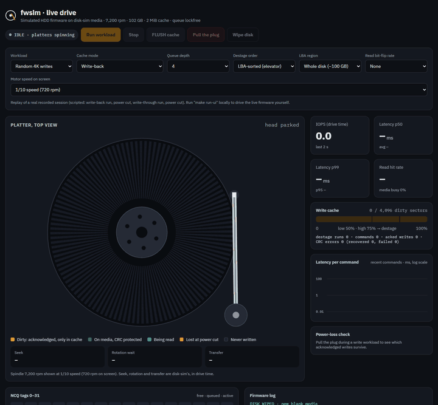
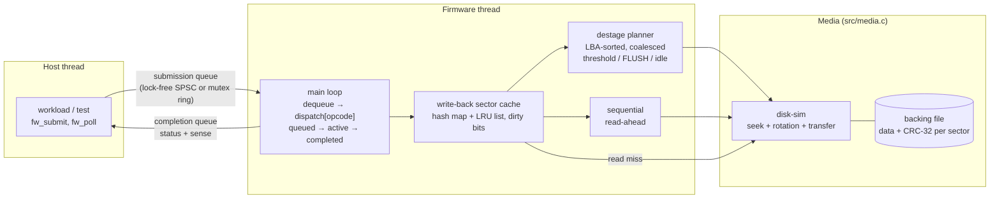
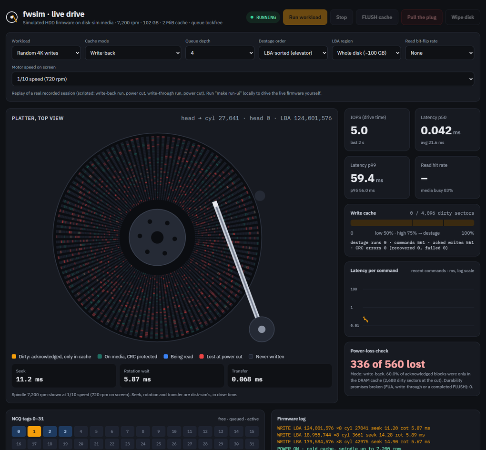
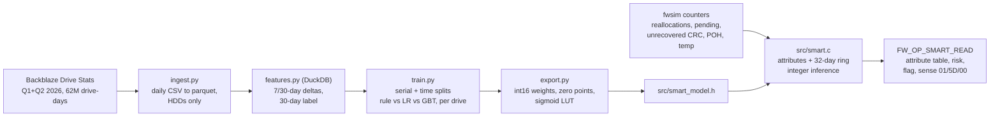

# fwsim: a simulated HDD firmware command processor

`fwsim` is the firmware layer of a hard drive, written in C11 with pthreads.
A host submits NCQ-style tagged commands (IDENTIFY, READ, WRITE with FUA,
FLUSH, SET FEATURES, and optionally SMART READ) into a submission queue. A dedicated firmware thread
decodes them through an opcode dispatch table, serves them from a write-back
LRU sector cache, and moves data to and from "platters". Each sector on the
platters carries a CRC-32. Completions with SCSI-style sense data go back
through a completion queue.

It sits on top of my earlier project **disk-sim**,
which models the mechanics (zoned geometry, seek curve, rotational latency,
defect slipping and G-list reallocation). disk-sim answers *how long* a media
access takes; fwsim decides *which* accesses happen, *when*, and *what the
host is told*. Together they are one simulated drive: disk-sim is the head
and platters, fwsim is the controller firmware.



*The live dashboard on a real session: random 4K writes with write-back
caching at 1/10 speed (the platter spins at 720 rpm on screen). Orange
sectors are acknowledged but only in the DRAM cache; the arm destages them
to the platter in LBA order, turning them teal. Then the plug is pulled: the
spindle coasts down, the drive reboots, and every acknowledged block is read
back. 336 of 560 were lost (red), 0 durability promises broken.
**[Watch the recorded session online](https://chiranthan-dev.github.io/fwsim/)**,
or run it live yourself (see [Run it in WSL](#run-it-in-wsl)).*

> **This is simulated firmware, not real drive code.** It runs as a user-space
> program on Linux, uses a file as its platters, and models timing rather than
> controlling hardware. The concepts (NCQ tags, write-back caching, FUA/FLUSH
> semantics, destaging, CRC + retry + MEDIUM ERROR, power-loss behaviour) are
> real, and so is every number in this README: all of them come from
> `make bench` runs on this code.

## Architecture



Command path for a write in write-back mode: the host claims a tag
(atomic bitmap), pushes the command, and the firmware pops it. The command
moves to ACTIVE, `dispatch[FW_OP_WRITE]` copies the data into cache entries
and marks them dirty, and the completion is posted. That's the moment the
host is told "written". The media is touched later, when the destage planner
writes the oldest dirty sectors in LBA order. With FUA, or with the cache in
write-through mode, the media write happens *before* the completion.

| File | What it is |
|---|---|
| [src/fwsim.h](src/fwsim.h) | Public API: command struct, opcodes, status/sense codes, config, stats |
| [src/firmware.c](src/firmware.c) | Firmware thread, dispatch table, handlers, destage planner, read-ahead |
| [src/cache.c](src/cache.c) | LRU sector cache: hash map + doubly linked list, dirty bits |
| [src/media.c](src/media.c) | disk-sim timing + backing file + CRC-32 + retries + fault injection + torn writes |
| [src/ring_spsc.c](src/ring_spsc.c) | Lock-free single-producer/single-consumer ring (C11 acquire/release) |
| [src/ring_mutex.c](src/ring_mutex.c) | Bounded ring with mutex + two condition variables |
| [src/squeue.h](src/squeue.h) | Build-time switch between the two rings |
| [src/crc32.c](src/crc32.c) | Table-driven CRC-32 (built once under `pthread_once`) |
| [src/status.c](src/status.c) | Status → SCSI sense key / ASC / ASCQ |
| [src/powerloss.c](src/powerloss.c) | Power-loss trial: write, cut, reboot, verify |
| [src/workload.c](src/workload.c) | Closed-loop host workload generator at a fixed queue depth |
| [bench/bench.c](bench/bench.c), [bench/plot.py](bench/plot.py) | Every experiment → CSV → markdown + PNG |
| [ui/server.c](ui/server.c), [ui/static/](ui/static) | Live web dashboard: C server (SSE) + canvas animation of platter and arm |
| [tests/](tests/) | Unit + integration tests (rings, cache, CRC, dispatch, integrity, power loss) |
| [third_party/disk-sim](third_party/disk-sim) | Snapshot of the disk-sim media library (used if no sibling checkout exists) |

## Build and run

You need Linux (or WSL) with gcc, make and pthreads. There are no other C
dependencies. `make bench` also wants Python 3 with matplotlib for the PNGs;
the CSV and markdown are produced without it.

disk-sim is picked up from a sibling checkout (`../disk-sim` or
`../Projects/disk-sim`) if there is one. Otherwise the build falls back to
[third_party/disk-sim](third_party/disk-sim), a snapshot of its library
sources (`include/disksim.h` plus `src/`, without its CLI), so a fresh clone
of this repository builds on its own. Pass `DISKSIM_DIR=...` to point
anywhere else.

```bash
make                  # build/lockfree/{fwsim,fwbench}
```
```bash
make test             # all tests, lock-free AND mutex queue builds
```
```bash
make asan             # same, under AddressSanitizer + UBSan
```
```bash
make tsan             # same, under ThreadSanitizer
```
```bash
make bench            # ~2.5 min: results/results.csv, results.md, *.png
```
```bash
make QUEUE=mutex      # build with the mutex/condvar queue instead
```
```bash
make run-ui           # live web dashboard on http://localhost:8080 (see "Run it in WSL")
```
```bash
make smart-demo       # SMART risk timeline demo (no data needed)
```
```bash
make bench-smart      # SMART model end to end on Backblaze data (see "SMART failure prediction")
```
```bash
./build/lockfree/fwsim --workload mixed --ops 2000 --qd 4 --region 65536 --time-scale 0.25
```

The CLI prints IDENTIFY data, throughput, latency percentiles, cache hit
rate, destage, media and integrity counters for one workload. Run
`fwsim --help` to see the options (`--write-through`, `--fua`,
`--no-readahead`, `--unsorted-destage`, `--flip-prob P`, ...).

### Run it in WSL

From scratch on Windows 10/11:

1. **Install WSL with Ubuntu** (once). Run this in PowerShell, then restart
   if it asks you to:
   ```powershell
   wsl --install -d Ubuntu
   ```
2. **Open Ubuntu** (Start menu → Ubuntu) and install the toolchain. Python
   and matplotlib are only needed for `make bench`'s charts:
   ```bash
   sudo apt update && sudo apt install -y build-essential git python3-matplotlib
   ```
3. **Get the code.** Clone it into the Linux file system (`~`), not `/mnt/c`,
   because builds are much faster there:
   ```bash
   cd ~ && git clone https://github.com/chiranthan-dev/fwsim.git && cd fwsim
   ```
4. **Build and test:**
   ```bash
   make && make test
   ```
5. **Start the live dashboard:**
   ```bash
   make run-ui
   ```
   It prints `fwsim-ui: http://localhost:8080`. Leave it running.
6. **Open http://localhost:8080 in your normal Windows browser.** WSL
   forwards `localhost` to Windows automatically. Pick a workload, cache mode
   and motor speed, then press **Run workload**. Press **Pull the plug** at
   any moment to cut power, and watch the drive reboot and report which
   acknowledged writes survived.
7. Stop the server with **Ctrl+C** in the Ubuntu window. To use another
   port: `make run-ui UI_PORT=9000`.

If the dashboard doesn't load from Windows, open `http://127.0.0.1:8080`
instead, or check that nothing else is using port 8080.

### Live dashboard

 `fwsim-ui` ([ui/server.c](ui/server.c)) is a small C
server, still with no dependencies beyond pthreads and POSIX sockets. It runs
the real firmware and streams every media access and command to the page
over Server-Sent Events. The page ([ui/static/](ui/static)) draws:

- **The platter, spinning at the simulated rpm.** Its angle is
  `frac(t / rev_ms)` in drive time, the same rotational model disk-sim uses,
  so a target sector reaches the head exactly when disk-sim's rotational wait
  ends.
- **The actuator arm.** For every access it swings to the real cylinder over
  disk-sim's seek time, with an accelerate–decelerate–settle profile. A ring
  marks the target sector while it rotates round, and the sectors light up
  as they pass under the head.
- **Sector state, live:** orange is acknowledged but only in the DRAM cache,
  teal is on the media, red is lost at a power cut. These come from the
  firmware's own trace events: write-back acknowledgements, destage writes,
  and the post-reboot verification.
- **Live stats:** IOPS and p50/p95/p99 in drive time, read hit rate, media
  busy %, the dirty-cache meter with its 50%/75% watermarks, the latency of
  recent commands, the 32 NCQ tags (free, queued, active), a firmware log,
  and CRC errors.
- **Pull the plug:** cuts power mid-whatever-it-is-doing. The spindle coasts
  down, the head parks, the drive reboots, every acknowledged block is read
  back, and the card reports how many were lost and how many durability
  promises were broken (always 0).

**Online replay.** GitHub Pages can only serve static files, so it can't run
the C firmware. The [online copy](https://chiranthan-dev.github.io/fwsim/)
is the same page in replay mode: it plays back
[ui/static/demo-events.json](ui/static/demo-events.json), a real session
that [ui/record.py](ui/record.py) recorded from `fwsim-ui` (every event with
its original timing), through the same event handler the live stream uses.
Open `http://localhost:8080/?replay` to see the replay locally. The README
animation consists of real screenshots of that replay, captured with headless
Edge/Chrome ([docs/capture_dashboard.mjs](docs/capture_dashboard.mjs)) and
assembled by [docs/make_gif.py](docs/make_gif.py).

Motor speed: real time (7,200 rpm, 120 revolutions per second), or slowed
to 1/4, 1/10 or 1/40 so each seek and rotational wait is visible. The firmware
itself runs at the chosen speed (`time_scale`), so the animation is the
firmware's actual behaviour, not a replay. Switching the cache mode sends a
real SET FEATURES command. The server binds to 127.0.0.1 only.
`bash ui/tsan_smoke.sh` (after `make SAN=tsan ui`) drives the server through
runs, FLUSH, two power cuts and a wipe under ThreadSanitizer: 0 warnings.

### How time works

disk-sim returns the mechanical time of each access in milliseconds. The
firmware **plays that time back in real time, scaled by `time_scale`**: it
sleeps most of the interval, spins the last ~120 µs for precision, and can be
interrupted by a power cut part-way through. Playing time back for real is
what makes the concurrency genuine: the host keeps submitting while the
firmware is "seeking", and a power cut can land mid-seek or mid-destage.
The benchmarks use `time_scale = 0.25`, and all reported times are **drive
time = wall-clock ÷ 0.25**. CPU work in the firmware (memcpy, CRC, hashing)
is not scaled, so it is inflated 4× in drive-time terms. That's a known
approximation (see Limitations). Metrics marked *wall* (the queue
comparisons) are raw wall-clock.

## Results

All numbers below come from one `make bench` run on this code (WSL2
Ubuntu 24.04, gcc 13.3, 12 logical CPUs). The simulated drive is disk-sim's
default 7,200 rpm, ~100 GB, 16-zone drive with a 2 MiB (4,096 × 512 B)
cache. Raw data: [results/results.csv](results/results.csv) and
[results/powerloss_trials.csv](results/powerloss_trials.csv).

<!-- RESULTS:BEGIN -->
_Generated by `make bench` from `results/results.csv`. Time scale 0.25: times are drive time (wall-clock / 0.25) unless marked wall._

### Write-back vs write-through (QD 4, 2 MiB cache)

| Workload | Mode | IOPS (acked) | IOPS (incl. final FLUSH) | p50 ms | p95 ms | p99 ms | Read hit % |
|---|---|---:|---:|---:|---:|---:|---:|
| Random 4K writes, whole 100 GB disk | write-through | 73.1 | 73.1 | 54.20 | 70.03 | 77.04 | - |
| Random 4K writes, whole 100 GB disk | write-back | 190 | 148 | 0.07 | 61.76 | 68.37 | - |
| Random 4K writes, 1 GiB region | write-through | 165 | 165 | 24.11 | 32.87 | 35.72 | - |
| Random 4K writes, 1 GiB region | write-back | 237 | 184 | 0.03 | 51.44 | 56.16 | - |
| 70/30 read/write, 90% of I/O to a hot 1.6 MiB of 32 MiB | write-through | 435 | 435 | 8.77 | 19.68 | 23.95 | 70.0 |
| 70/30 read/write, 90% of I/O to a hot 1.6 MiB of 32 MiB | write-back | 998 | 684 | 2.08 | 14.67 | 18.94 | 70.0 |
| Random 4K reads, whole disk | write-through | 73.9 | 73.9 | 54.20 | 67.67 | 74.73 | 0.0 |
| Random 4K reads, whole disk | write-back | 73.9 | 73.9 | 54.38 | 68.52 | 73.82 | 0.0 |

### Power loss (random 4K writes over 32 MiB, QD 4, cut at a random moment 50-1000 ms)

| Mode | Trials | Acked writes / trial | Lost acked writes / trial (avg) | max | Trials with loss | Durability violations | Write IOPS |
|---|---:|---:|---:|---:|---:|---:|---:|
| Write-back, no FLUSH | 100 | 525 | 351 | 383 | 100 | 0 | 1,400 |
| Write-back + FLUSH every 32 writes | 100 | 122 | 18.5 | 31 | 100 | 0 | 284 |
| Write-back, every write FUA | 100 | 92.4 | 0.0 | 0 | 0 | 0 | 182 |
| Write-through (cache off) | 100 | 93.3 | 0.0 | 0 | 0 | 0 | 176 |

_Lost = the latest acknowledged version of a block is not on the media after reboot. Violation = data the drive promised was durable (FUA / write-through ack, or covered by a completed FLUSH) is missing. Write IOPS = acknowledged writes per second of drive time until the cut._

### Queues: mutex + condvar vs lock-free SPSC

| Measurement | mutex + condvar | lock-free SPSC | ratio |
|---|---:|---:|---:|
| Raw handoff, 1 producer -> 1 consumer, median of 5 (M items/s, wall) | 0.69 | 18.25 | 26.4x |
| Firmware cache-hit READs, QD 1 (K cmds/s, wall) | 20.9 | 1,177 | 56.4x |
| Firmware cache-hit READ latency avg, QD 1 (us, wall) | 47.72 | 0.66 | |
| Firmware cache-hit READs, QD 32 (K cmds/s, wall) | 1,038 | 2,418 | 2.3x |
| Firmware cache-hit READ latency avg, QD 32 (us, wall) | 30.66 | 13.03 | |

### Read-ahead and destage order

| Experiment | Variant | IOPS | IOPS (incl. FLUSH) | p50 ms | p99 ms | Read hit % |
|---|---|---:|---:|---:|---:|---:|
| Sequential 64K reads, QD 1 | read-ahead on | 743 | 743 | 1.24 | 3.29 | 99.9 |
| Sequential 64K reads, QD 1 | read-ahead off | 108 | 108 | 9.18 | 12.76 | 0.0 |
| Random 4K writes, write-back | LBA-sorted destage | 194 | 151 | 0.02 | 67.87 | - |
| Random 4K writes, write-back | age-order destage | 92.9 | 72.0 | 0.04 | 137.3 | - |

### Integrity (CRC-32 per sector, 3 retries)

CRC-32("123456789") = `0xCBF43926` (standard check value 0xCBF43926).

| Sectors read | Persistent flips injected | Transient flips injected | CRC errors detected | Recovered by retry | MEDIUM_ERROR returned (at injected LBA) | Silent corruptions |
|---:|---:|---:|---:|---:|---:|---:|
| 20,000 | 25 | 20 | 45 | 20 | 25 (25) | 0 |

<!-- RESULTS:END -->


## Key findings

1. **Acknowledged is not durable.** With write-back caching and no FLUSH,
   power loss destroyed acknowledged writes in **100 of 100 trials, 351.5 on
   average (max 383)**, out of about 525 acknowledged per trial. Write-through
   and FUA lost **0** in 200 trials, and no mode ever broke a durability
   promise (0 violations in 400 trials).
2. **FLUSH bounds the damage to the window since the last FLUSH.** With a
   FLUSH every 32 writes, the loss dropped to 18.5 writes per trial (max 31,
   always less than one FLUSH interval), with zero violations.
3. **Durability costs throughput.** In the same power-loss workload,
   acknowledged-write throughput was 1,400 IOPS for write-back, 284 with
   periodic FLUSH, 182 with FUA and 176 for write-through: write-back is
   **7.9×** write-through *until the cache fills*.
4. **Sustained, the cache only helps as much as destaging does.** On random
   4K writes over the whole disk, write-back is **2.0×** write-through when
   you include the final FLUSH (147.6 vs 73.1 IOPS). Median latency drops
   from 54 ms to 0.07 ms, but p99 stays mechanical (68 ms). The gain comes
   from **LBA-sorted destaging**, which alone is 2.1× age-order destaging
   (151.1 vs 72.0 IOPS) and halves p99 (68 vs 137 ms).
5. **Write-back can hurt tail latency.** On random writes confined to 1 GiB,
   write-back p99 was **56 ms vs 36 ms** for write-through: commands queue
   behind background destage writes. Moving media work out of the write path
   doesn't make it disappear.
6. **A hot set that fits in the cache wins twice.** The 70/30 mixed workload
   hit the cache 70% of the time and ran 1.57× faster in write-back (684 vs
   435 IOPS, incl. FLUSH), with p50 down from 8.8 to 2.1 ms.
7. **Read-ahead is about rotation, not just hit rate.** Sequential 64 KiB
   reads at QD 1 ran **6.9× faster** with read-ahead (743 vs 108 IOPS).
   Without it, every command misses a revolution (≈9.2 ms p50 ≈ one 8.3 ms
   revolution plus transfer).
8. **Lock-free beats mutex+condvar most when queues run empty.** The raw
   handoff rate was **26×** higher (18.25 vs 0.69 M items/s). On the real
   firmware at QD 1, cache-hit command rate was **56×** higher (1,177 vs 20.9
   K/s, 0.66 vs 47.7 µs average latency), because every mutex handoff paid a
   futex sleep and wake. At QD 32 the gap shrinks to 2.3×.
9. **CRC + retry: everything detected, nothing silent.** Across 20,000 sector
   reads with 20 transient and 25 persistent bit flips: 45 CRC errors were
   detected, all 20 transient ones were recovered by retry, all 25 persistent
   ones were reported as MEDIUM ERROR at exactly the injected LBA, and there
   were **0 silent corruptions**.

## Examples

These are captures of real runs. [docs/capture.sh](docs/capture.sh) runs
each command and saves its unedited output to `docs/screenshots/*.txt`, and
[docs/render.py](docs/render.py) draws that text as a terminal image. Re-run
both to regenerate them.

**One workload on the CLI.** IDENTIFY, then a 70/30 random read/write mix
over 32 MiB at QD 4. Access is uniform here (the CLI has no hot-set option),
so most reads miss; the benchmark's `mixed_hot` workload adds the hot set:


**Write-back vs write-through, same workload.** Compare the IOPS, the
latency and the destage counters:


**Fault injection.** With a 1% chance of a read-channel bit flip per sector,
CRC errors are detected and recovered by retry:


**The power-loss integration test**, including a torn write and the
randomised per-mode trials:


**The power-loss benchmark** (20 trials per mode here; `make bench` runs 100):


**ThreadSanitizer and AddressSanitizer** over the whole suite, both queue
builds:


Using the API directly (this is what `fw_exec` wraps):

```c
fw_config_t cfg;
fw_config_default(&cfg);
cfg.media_path = "/tmp/drive.media";
cfg.time_scale = 0.25;                 /* media time played back at 1/4 speed */
fw_t *fw = fw_create(&cfg, NULL);      /* powers on, starts the firmware thread */

uint8_t buf[8 * 512] = { 0 };
fw_cmd_t w = { .opcode = FW_OP_WRITE, .tag = 0, .lba = 4096, .count = 8,
               .buf = buf, .flags = FW_CMD_FUA };     /* durable before the ack */
fw_submit(fw, &w);                     /* ownership passes to the firmware */
fw_cmd_t *done = fw_poll(fw, 100000);  /* ...and back with the completion */
printf("%s, sense %X/%02X\n", fw_status_str(done->status),
       done->sense.key, done->sense.asc);

fw_shutdown(fw);                       /* destage everything, stop */
fw_destroy(fw);
```

## SMART failure prediction

**Problem.** Drives usually give warning before they die: sectors get
reallocated, reads become uncorrectable, unreadable sectors pile up as
"pending". SMART exposes those counters. The question is whether a small
model *inside the firmware* can turn them into a better "replace me soon"
signal than the classic rule, *flag the drive if any of SMART 5, 187, 188,
197 or 198 is above zero*.

The target: **will this drive fail within the next 30 days?**

**Data.** Backblaze Drive Stats Q1 + Q2 2026 (public daily SMART snapshots
with a failure flag). That is 61.9 M drive-days from 359,507 data HDDs
(Toshiba, Seagate, HGST, WDC; 4 TB and up), 2,552 of which failed. It is
processed in chunks: one daily CSV at a time, then DuckDB out of core. The
raw data is not in git; [tools/smart/README.md](tools/smart/README.md) has
the exact download steps.



**How it is evaluated.**
- **Per drive, not per row.** A drive's score is its highest daily score in
  the test window. The false-alarm rate is the share of healthy drives
  flagged at least once.
- **Two leakage-safe splits.**
  - *Serial split*: 80/20 by drive serial number.
  - *Time split*: train on Feb–Mar, test on May. A 30-day gap means no
    training label can see the test window.
- **Never accuracy.** Predicting "never fails" would already be 99.8%
  accurate on the time split.

The deployed threshold is chosen for 1% false alarms on the *training*
period, never on the test set.

**Results (time split: 350,500 test drives, 843 failures).**

| Model | PR-AUC | Recall at 1% false alarms |
|---|---:|---:|
| Baseline rule, graded (sum of the five raw counters) | 0.033 | 12.2% |
| **Logistic regression, 17 deployable features (in fwsim)** | **0.189** | **52.9%** |
| Logistic regression, + vendor-normalised values | 0.196 | 52.6% |
| Gradient-boosted trees (60 × depth 3) | 0.208 | 60.1% |

- **The rule as written** ("any raw > 0") catches 76.5% of failures, but it
  flags **8.5%** of healthy drives: 29,805 false alarms for 645 hits.
  **At that same 8.5% the model only reaches 77.8%. At the rule's own
  operating point the model does not meaningfully beat it.** The gain is
  at low false-alarm rates: at 1%, the model catches 4× as many failures
  as the graded rule.
- **The deployed threshold**, chosen on training data, gives 53.9% recall
  at 1.08% false alarms on the test month (precision 10.7%).
- **Serial split:** recall at 1% false alarms 61.4% (model) vs 11.0%
  (graded baseline).
- **By manufacturer:** the model helps most on Seagate (64.6% vs 19.9%) and
  Toshiba (51.8% vs 42.3%). It is level with the baseline on HGST and WDC,
  and slightly *below* it for both on the serial split.
- **GBT vs this model:** GBT is better (60.1% vs 52.9%), but it would mean
  shipping 896 tree nodes instead of 17 weights.


Full tables (both splits, per manufacturer and per Toshiba model, bootstrap
CIs): [results/smart/results.md](results/smart/results.md). Model details
and failure modes: [docs/model-card.md](docs/model-card.md).

**In the firmware.** `src/smart.c` keeps SMART attributes from counters the
simulator already had:

| Attribute | Source in fwsim |
|---|---|
| 5 (reallocated) | G-list reallocations |
| 187 (reported uncorrectable) | reads that failed every CRC retry |
| 197 (pending) | unreadable LBAs awaiting rewrite |
| 9 (power-on hours) | simulated time |
| 194 (temperature) | an input |

A 32-entry ring holds one sample per simulated day, which gives the 7- and
30-day deltas. Inference is integer-only (no FPU, no malloc):

- **C vs Python:** on all 10.8 M test drive-days the C model equals the
  Python integer reference bit for bit. Its flag agrees with the float
  scikit-learn model in 100% of rows (max probability error 0.0011).
- **Why int16 weights:** int8 was measured first and cost up to 3.8
  percentage points of probability.
- **Cost:** 602 bytes of tables; about 15 ns per inference (~275 ns with feature computation; varies run to run) on the host CPU
  (not drive-controller timing).

`FW_OP_SMART_READ` returns the attribute table, the risk and the flag. While
the flag is tripped it completes with the SCSI informational exception
RECOVERED ERROR 5D/00. SMART is **off by default**: IDENTIFY advertises it,
and `SET FEATURES 0xD8` or `fw_config_t.smart_enable` turns it on. With it
off, every existing test and every deterministic CLI/bench output is
identical to before.

**Deployment demo, synthetic counters.** `make smart-demo` runs a
20,000-hour drive for 8 simulated weeks. From day 14 a growing scratch adds
grown defects and unrecoverable reads. Risk stays at 0.03% while the drive
is healthy and the flag trips on day 21. *The defects are scripted. The
demo shows the plumbing works; the accuracy claims come only from the
Backblaze test set.*


**Reproduce:** `tools/smart/download.sh tools/smart/data`, then
`make bench-smart` (about 10 minutes; details in
[tools/smart/README.md](tools/smart/README.md)).

**Limitations.**
- **One fleet, one half-year.** Backblaze's workload, cooling and
  replacement policy are baked in, and drift is already visible: recall at
  1% false alarms falls from 61% on the serial split to 53% two months
  later.
- **Silent failures cap recall.** 23.5% of the test-month failures never
  showed any of the five counters.
- **The simulator's counters are synthetic.** 188 and 198 are always 0 in
  fwsim, and temperature is an input, not a thermal model.
- **Host timing is not drive timing.** A Cortex-R class controller is
  slower, and the model would run once per SMART poll, not per I/O.

## Design decisions

- **One firmware thread owns the cache, the media and the disk-sim handle.**
  A single-core controller runs its command and cache layer exactly like
  this. It means the cache and media code have no locks, no lock ordering
  and no lock overhead, and the only shared state is the queues, the power
  flags, the tag bitmap and the counters. The alternative, a locked cache
  with multiple worker threads, would add contention and still be limited
  by one actuator.
- **Ownership transfer through the queues instead of locking commands.**
  Release/acquire on the queue indices publishes the whole command struct,
  so it needs no lock or atomics of its own.
- **Two queue implementations behind a build-time switch** (`make
  QUEUE=mutex|lockfree`). A static inline wrapper costs nothing on the hot
  path; a runtime function pointer would add an indirect call to the thing
  being measured. Both rings are always compiled, so their unit tests run in
  every build.
- **Per-sector cache entries.** Real drives cache segments, but per-sector
  entries make LRU, dirty tracking and the tests exact. Destage coalescing
  recovers the large sequential media writes.
- **Hash map + doubly linked list LRU, preallocated.** O(1) lookup, touch
  and evict, with no malloc on the I/O path. Eviction skips dirty entries
  because their data exists nowhere else.
- **Background destage as a sorted plan executed in slices** (2 media writes
  between host commands, 1 at a time when the queue is empty). Writing a
  whole 1,000-sector batch at once gave terrible tail latency. Storing LBAs
  rather than pointers in the plan keeps it correct when entries are
  rewritten, cleaned by FUA or evicted mid-plan.
- **Watermark hysteresis (75% → 50%).** It batches enough dirty data to sort
  into an efficient sweep, instead of destaging one sector per write.
- **CRC-32 seeded with the LBA.** It catches misdirected writes as well as
  bit flips. An all-zero record means "never written", so a fresh sparse
  backing file reads as zeros without a format pass.
- **Unrecoverable sectors go on a pending list and are reallocated on the next
  write** (via disk-sim's G-list), never at read time, so the host's data is
  never silently replaced.
- **Power-loss checker distinguishes "lost" from "violation".** Losing
  acknowledged-but-unflushed write-back data is *allowed*; losing data the
  drive promised was durable is a bug. Only the second must be zero.
- **disk-sim compiled from source per build variant.** The sanitizers then
  instrument the media model too. No change to disk-sim's API was needed:
  everything fwsim uses was already public (`disk_service_request`,
  `disk_get_info`, `disk_add_grown_defect`, ...).

## Testing

`make test` runs seven test programs, twice (once per queue implementation),
plus five end-to-end CLI runs and the SMART demo. `make asan` and `make tsan` run the same
thing under the sanitizers, and both report nothing. I sanity-checked that
TSan in this environment does catch a deliberately racy program.

| Test | Covers |
|---|---|
| `test_ring` | both rings: empty/full, FIFO, wrap-around, `size_t` counter overflow, timeouts, close, 2-thread stress (2 M items), MPMC for the mutex ring, payload publication |
| `test_cache` | LRU order, touch vs peek, dirty never evicted, all-dirty refusal, overwrite/dirty transitions, oldest-first dirty collection, discard, randomized 50k-op comparison against a reference model, strided-LBA hashing |
| `test_crc` | check value 0xCBF43926, known vectors, table vs bitwise, incremental, every single-bit flip detected, bursts ≤ 32 bits detected, concurrent first use |
| `test_dispatch` | IDENTIFY, invalid opcodes + sense, range/overflow validation, tag collision, all 32 tags in flight, FLUSH, FUA, write-through, SET FEATURES, threshold and forced destage, unsorted destage, read-ahead, clean shutdown persistence |
| `test_integrity` | persistent flip → retries → MEDIUM_ERROR at the exact LBA, CRC-field flip, reallocation on rewrite, transient flips recovered with zero silent corruption, misdirected write caught |
| `test_powerloss` | deterministic contracts per mode, torn write is a clean prefix, randomized trials per mode with zero durability violations |
| `test_smart` | attribute mapping from the firmware counters (5/187/197/9/194), history ring wrap-around and idle gaps, exported model bit-exact vs the Python reference (510 Backblaze test vectors, ≤ 1 pp vs float), SMART_READ invalid fields → 05/24/00, disabled → 05/2C/00, failure predicted → 01/5D/00 |

The Python side has its own tests (`python -m pytest tools/smart/tests`):
- no serial in both splits;
- time-split labels never reach the test window;
- the 30-day label and the 7/30-day deltas on a synthetic dataset run through the real DuckDB SQL;
- the baseline rule;
- deterministic training with a fixed seed;
- the integer transform and quantisation bounds.

## Limitations

- **Simulated firmware, not real drive code.** No real hardware, interrupts,
  DMA, or SATA/SAS/NVMe protocol. Commands are C structs in shared memory.
- **The firmware executes commands in FIFO order.** Real NCQ firmware
  reorders queued commands by rotational position (that is what disk-sim's
  SPTF scheduler models). Here, only *destaging* is reordered.
- **CPU time is not scaled.** Firmware CPU work is inflated by 1/time_scale
  (4× in the benchmarks) in drive-time terms. That mostly affects cache-hit
  and sequential workloads.
- **Read-ahead streaming** is modelled by starting a continuing prefetch at
  the instant the previous read ended. The transfer time is still charged
  in full, which is conservative.
- **The cache is volatile and there is no power-loss protection.** Nothing
  survives a cut except what is on the media.
- **CRC only, no ECC.** Errors are detected and retried, never corrected.
  Real drives correct most errors with LDPC in the read channel.
- **Torn writes** are modelled at sector granularity within one
  positioning-plus-transfer; a request spanning several tracks is
  approximated.
- **Timing noise.** Wall-clock measurements on a shared WSL2 VM vary from run
  to run, by roughly 10–50% for the queue micro-benchmark. The structural
  results (who wins, zero violations, zero silent corruptions) are stable
  across runs.

## Future work

- Rotational-position (SPTF) reordering of queued host commands, reusing
  disk-sim's `disk_estimate_access()`.
- Read-priority destage scheduling (pause destage while reads are queued) and
  adaptive watermarks.
- Segment-based cache and adaptive read-ahead length.
- An ECC model (e.g. a simple Reed–Solomon or BCH code per sector) so the
  firmware can *correct* as well as detect errors, and correction latency
  shows up in the timing.
- Power-loss protection: a capacitor energy budget that allows destaging N
  sectors after the cut.
- An NVMe-style multi-queue front end (one SPSC queue pair per host core).
