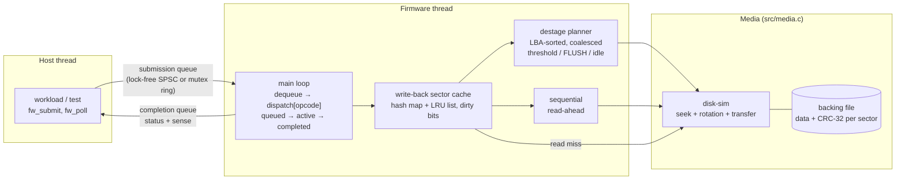
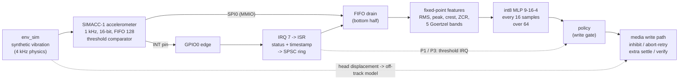

# fwsim: a simulated HDD firmware command processor

`fwsim` is the firmware layer of a hard drive, written in C11 with pthreads.
A host submits NCQ-style tagged commands (IDENTIFY, READ, WRITE with FUA,
FLUSH, SET FEATURES) into a submission queue. A dedicated firmware thread
decodes them through an opcode dispatch table, serves them from a write-back
LRU sector cache, and moves data to and from "platters". Each sector on the
platters carries a CRC-32. Completions with SCSI-style sense data go back
through a completion queue.

It sits on top of my earlier project **disk-sim**,
which models the mechanics (zoned geometry, seek curve, rotational latency,
defect slipping and G-list reallocation). disk-sim answers *how long* a media
access takes; fwsim decides *which* accesses happen, *when*, and *what the
host is told*. Together they are one simulated drive: disk-sim is the head
and platters, fwsim is the controller firmware.


*The live dashboard on a real session: random 4K writes with write-back
caching at 1/10 speed (the platter spins at 720 rpm on screen). Orange
sectors are acknowledged but only in the DRAM cache; the arm destages them
to the platter in LBA order, turning them teal. Then the plug is pulled: the
spindle coasts down, the drive reboots, and every acknowledged block is read
back. 336 of 560 were lost (red), 0 durability promises broken.
**[Watch the recorded session online](https://chiranthan-dev.github.io/fwsim/)**,
or run it live yourself (see [Run it in WSL](#run-it-in-wsl)).*

> **This is simulated firmware, not real drive code.** It runs as a user-space
> program on Linux, uses a file as its platters, and models timing rather than
> controlling hardware. The concepts (NCQ tags, write-back caching, FUA/FLUSH
> semantics, destaging, CRC + retry + MEDIUM ERROR, power-loss behaviour) are
> real, and so is every number in this README: all of them come from
> `make bench` runs on this code.

## Architecture



Command path for a write in write-back mode: the host claims a tag
(atomic bitmap), pushes the command, and the firmware pops it. The command
moves to ACTIVE, `dispatch[FW_OP_WRITE]` copies the data into cache entries
and marks them dirty, and the completion is posted. That's the moment the
host is told "written". The media is touched later, when the destage planner
writes the oldest dirty sectors in LBA order. With FUA, or with the cache in
write-through mode, the media write happens *before* the completion.

| File | What it is |
|---|---|
| [src/fwsim.h](src/fwsim.h) | Public API: command struct, opcodes, status/sense codes, config, stats |
| [src/firmware.c](src/firmware.c) | Firmware thread, dispatch table, handlers, destage planner, read-ahead |
| [src/cache.c](src/cache.c) | LRU sector cache: hash map + doubly linked list, dirty bits |
| [src/media.c](src/media.c) | disk-sim timing + backing file + CRC-32 + retries + fault injection + torn writes |
| [src/ring_spsc.c](src/ring_spsc.c) | Lock-free single-producer/single-consumer ring (C11 acquire/release) |
| [src/ring_mutex.c](src/ring_mutex.c) | Bounded ring with mutex + two condition variables |
| [src/squeue.h](src/squeue.h) | Build-time switch between the two rings |
| [src/crc32.c](src/crc32.c) | Table-driven CRC-32 (built once under `pthread_once`) |
| [src/status.c](src/status.c) | Status → SCSI sense key / ASC / ASCQ |
| [src/powerloss.c](src/powerloss.c) | Power-loss trial: write, cut, reboot, verify |
| [src/workload.c](src/workload.c) | Closed-loop host workload generator at a fixed queue depth |
| [bench/bench.c](bench/bench.c), [bench/plot.py](bench/plot.py) | Every experiment → CSV → markdown + PNG |
| [ui/server.c](ui/server.c), [ui/static/](ui/static) | Live web dashboard: C server (SSE) + canvas animation of platter and arm |
| [tests/](tests/) | Unit + integration tests (rings, cache, CRC, dispatch, integrity, power loss) |
| [third_party/disk-sim](third_party/disk-sim) | Snapshot of the disk-sim media library (used if no sibling checkout exists) |

## Build and run

You need Linux (or WSL) with gcc, make and pthreads. There are no other C
dependencies. `make bench` also wants Python 3 with matplotlib for the PNGs;
the CSV and markdown are produced without it.

disk-sim is picked up from a sibling checkout (`../disk-sim` or
`../Projects/disk-sim`) if there is one. Otherwise the build falls back to
[third_party/disk-sim](third_party/disk-sim), a snapshot of its library
sources (`include/disksim.h` plus `src/`, without its CLI), so a fresh clone
of this repository builds on its own. Pass `DISKSIM_DIR=...` to point
anywhere else.

```bash
make                  # build/lockfree/{fwsim,fwbench}
```
```bash
make test             # all tests, lock-free AND mutex queue builds
```
```bash
make asan             # same, under AddressSanitizer + UBSan
```
```bash
make tsan             # same, under ThreadSanitizer
```
```bash
make bench            # ~2.5 min: results/results.csv, results.md, *.png
```
```bash
make QUEUE=mutex      # build with the mutex/condvar queue instead
```
```bash
make run-ui           # live web dashboard on http://localhost:8080 (see "Run it in WSL")
```
```bash
./build/lockfree/fwsim --workload mixed --ops 2000 --qd 4 --region 65536 --time-scale 0.25
```

The CLI prints IDENTIFY data, throughput, latency percentiles, cache hit
rate, destage, media and integrity counters for one workload. Run
`fwsim --help` to see the options (`--write-through`, `--fua`,
`--no-readahead`, `--unsorted-destage`, `--flip-prob P`, ...).

### Run it in WSL

From scratch on Windows 10/11:

1. **Install WSL with Ubuntu** (once). Run this in PowerShell, then restart
   if it asks you to:
   ```powershell
   wsl --install -d Ubuntu
   ```
2. **Open Ubuntu** (Start menu → Ubuntu) and install the toolchain. Python
   and matplotlib are only needed for `make bench`'s charts:
   ```bash
   sudo apt update && sudo apt install -y build-essential git python3-matplotlib
   ```
3. **Get the code.** Clone it into the Linux file system (`~`), not `/mnt/c`,
   because builds are much faster there:
   ```bash
   cd ~ && git clone https://github.com/chiranthan-dev/fwsim.git && cd fwsim
   ```
4. **Build and test:**
   ```bash
   make && make test
   ```
5. **Start the live dashboard:**
   ```bash
   make run-ui
   ```
   It prints `fwsim-ui: http://localhost:8080`. Leave it running.
6. **Open http://localhost:8080 in your normal Windows browser.** WSL
   forwards `localhost` to Windows automatically. Pick a workload, cache mode
   and motor speed, then press **Run workload**. Press **Pull the plug** at
   any moment to cut power, and watch the drive reboot and report which
   acknowledged writes survived.
7. Stop the server with **Ctrl+C** in the Ubuntu window. To use another
   port: `make run-ui UI_PORT=9000`.

If the dashboard doesn't load from Windows, open `http://127.0.0.1:8080`
instead, or check that nothing else is using port 8080.

### Live dashboard

 `fwsim-ui` ([ui/server.c](ui/server.c)) is a small C
server, still with no dependencies beyond pthreads and POSIX sockets. It runs
the real firmware and streams every media access and command to the page
over Server-Sent Events. The page ([ui/static/](ui/static)) draws:

- **The platter, spinning at the simulated rpm.** Its angle is
  `frac(t / rev_ms)` in drive time, the same rotational model disk-sim uses,
  so a target sector reaches the head exactly when disk-sim's rotational wait
  ends.
- **The actuator arm.** For every access it swings to the real cylinder over
  disk-sim's seek time, with an accelerate–decelerate–settle profile. A ring
  marks the target sector while it rotates round, and the sectors light up
  as they pass under the head.
- **Sector state, live:** orange is acknowledged but only in the DRAM cache,
  teal is on the media, red is lost at a power cut. These come from the
  firmware's own trace events: write-back acknowledgements, destage writes,
  and the post-reboot verification.
- **Live stats:** IOPS and p50/p95/p99 in drive time, read hit rate, media
  busy %, the dirty-cache meter with its 50%/75% watermarks, the latency of
  recent commands, the 32 NCQ tags (free, queued, active), a firmware log,
  and CRC errors.
- **Pull the plug:** cuts power mid-whatever-it-is-doing. The spindle coasts
  down, the head parks, the drive reboots, every acknowledged block is read
  back, and the card reports how many were lost and how many durability
  promises were broken (always 0).

**Online replay.** GitHub Pages can only serve static files, so it can't run
the C firmware. The [online copy](https://chiranthan-dev.github.io/fwsim/)
is the same page in replay mode: it plays back
[ui/static/demo-events.json](ui/static/demo-events.json), a real session
that [ui/record.py](ui/record.py) recorded from `fwsim-ui` (every event with
its original timing), through the same event handler the live stream uses.
Open `http://localhost:8080/?replay` to see the replay locally. The README
animation consists of real screenshots of that replay, captured with headless
Edge/Chrome ([docs/capture_dashboard.mjs](docs/capture_dashboard.mjs)) and
assembled by [docs/make_gif.py](docs/make_gif.py).

Motor speed: real time (7,200 rpm, 120 revolutions per second), or slowed
to 1/4, 1/10 or 1/40 so each seek and rotational wait is visible. The firmware
itself runs at the chosen speed (`time_scale`), so the animation is the
firmware's actual behaviour, not a replay. Switching the cache mode sends a
real SET FEATURES command. The server binds to 127.0.0.1 only.
`bash ui/tsan_smoke.sh` (after `make SAN=tsan ui`) drives the server through
runs, FLUSH, two power cuts and a wipe under ThreadSanitizer: 0 warnings.

### How time works

disk-sim returns the mechanical time of each access in milliseconds. The
firmware **plays that time back in real time, scaled by `time_scale`**: it
sleeps most of the interval, spins the last ~120 µs for precision, and can be
interrupted by a power cut part-way through. Playing time back for real is
what makes the concurrency genuine: the host keeps submitting while the
firmware is "seeking", and a power cut can land mid-seek or mid-destage.
The benchmarks use `time_scale = 0.25`, and all reported times are **drive
time = wall-clock ÷ 0.25**. CPU work in the firmware (memcpy, CRC, hashing)
is not scaled, so it is inflated 4× in drive-time terms. That's a known
approximation (see Limitations). Metrics marked *wall* (the queue
comparisons) are raw wall-clock.

## Results

All numbers below come from one `make bench` run on this code (WSL2
Ubuntu 24.04, gcc 13.3, 12 logical CPUs). The simulated drive is disk-sim's
default 7,200 rpm, ~100 GB, 16-zone drive with a 2 MiB (4,096 × 512 B)
cache. Raw data: [results/results.csv](results/results.csv) and
[results/powerloss_trials.csv](results/powerloss_trials.csv).

<!-- RESULTS:BEGIN -->
_Generated by `make bench` from `results/results.csv`. Time scale 0.25: times are drive time (wall-clock / 0.25) unless marked wall._

### Write-back vs write-through (QD 4, 2 MiB cache)

| Workload | Mode | IOPS (acked) | IOPS (incl. final FLUSH) | p50 ms | p95 ms | p99 ms | Read hit % |
|---|---|---:|---:|---:|---:|---:|---:|
| Random 4K writes, whole 100 GB disk | write-through | 73.1 | 73.1 | 54.20 | 70.03 | 77.04 | - |
| Random 4K writes, whole 100 GB disk | write-back | 190 | 148 | 0.07 | 61.76 | 68.37 | - |
| Random 4K writes, 1 GiB region | write-through | 165 | 165 | 24.11 | 32.87 | 35.72 | - |
| Random 4K writes, 1 GiB region | write-back | 237 | 184 | 0.03 | 51.44 | 56.16 | - |
| 70/30 read/write, 90% of I/O to a hot 1.6 MiB of 32 MiB | write-through | 435 | 435 | 8.77 | 19.68 | 23.95 | 70.0 |
| 70/30 read/write, 90% of I/O to a hot 1.6 MiB of 32 MiB | write-back | 998 | 684 | 2.08 | 14.67 | 18.94 | 70.0 |
| Random 4K reads, whole disk | write-through | 73.9 | 73.9 | 54.20 | 67.67 | 74.73 | 0.0 |
| Random 4K reads, whole disk | write-back | 73.9 | 73.9 | 54.38 | 68.52 | 73.82 | 0.0 |

### Power loss (random 4K writes over 32 MiB, QD 4, cut at a random moment 50-1000 ms)

| Mode | Trials | Acked writes / trial | Lost acked writes / trial (avg) | max | Trials with loss | Durability violations | Write IOPS |
|---|---:|---:|---:|---:|---:|---:|---:|
| Write-back, no FLUSH | 100 | 525 | 351 | 383 | 100 | 0 | 1,400 |
| Write-back + FLUSH every 32 writes | 100 | 122 | 18.5 | 31 | 100 | 0 | 284 |
| Write-back, every write FUA | 100 | 92.4 | 0.0 | 0 | 0 | 0 | 182 |
| Write-through (cache off) | 100 | 93.3 | 0.0 | 0 | 0 | 0 | 176 |

_Lost = the latest acknowledged version of a block is not on the media after reboot. Violation = data the drive promised was durable (FUA / write-through ack, or covered by a completed FLUSH) is missing. Write IOPS = acknowledged writes per second of drive time until the cut._

### Queues: mutex + condvar vs lock-free SPSC

| Measurement | mutex + condvar | lock-free SPSC | ratio |
|---|---:|---:|---:|
| Raw handoff, 1 producer -> 1 consumer, median of 5 (M items/s, wall) | 0.69 | 18.25 | 26.4x |
| Firmware cache-hit READs, QD 1 (K cmds/s, wall) | 20.9 | 1,177 | 56.4x |
| Firmware cache-hit READ latency avg, QD 1 (us, wall) | 47.72 | 0.66 | |
| Firmware cache-hit READs, QD 32 (K cmds/s, wall) | 1,038 | 2,418 | 2.3x |
| Firmware cache-hit READ latency avg, QD 32 (us, wall) | 30.66 | 13.03 | |

### Read-ahead and destage order

| Experiment | Variant | IOPS | IOPS (incl. FLUSH) | p50 ms | p99 ms | Read hit % |
|---|---|---:|---:|---:|---:|---:|
| Sequential 64K reads, QD 1 | read-ahead on | 743 | 743 | 1.24 | 3.29 | 99.9 |
| Sequential 64K reads, QD 1 | read-ahead off | 108 | 108 | 9.18 | 12.76 | 0.0 |
| Random 4K writes, write-back | LBA-sorted destage | 194 | 151 | 0.02 | 67.87 | - |
| Random 4K writes, write-back | age-order destage | 92.9 | 72.0 | 0.04 | 137.3 | - |

### Integrity (CRC-32 per sector, 3 retries)

CRC-32("123456789") = `0xCBF43926` (standard check value 0xCBF43926).

| Sectors read | Persistent flips injected | Transient flips injected | CRC errors detected | Recovered by retry | MEDIUM_ERROR returned (at injected LBA) | Silent corruptions |
|---:|---:|---:|---:|---:|---:|---:|
| 20,000 | 25 | 20 | 45 | 20 | 25 (25) | 0 |

<!-- RESULTS:END -->


## Key findings

1. **Acknowledged is not durable.** With write-back caching and no FLUSH,
   power loss destroyed acknowledged writes in **100 of 100 trials, 351.5 on
   average (max 383)**, out of about 525 acknowledged per trial. Write-through
   and FUA lost **0** in 200 trials, and no mode ever broke a durability
   promise (0 violations in 400 trials).
2. **FLUSH bounds the damage to the window since the last FLUSH.** With a
   FLUSH every 32 writes, the loss dropped to 18.5 writes per trial (max 31,
   always less than one FLUSH interval), with zero violations.
3. **Durability costs throughput.** In the same power-loss workload,
   acknowledged-write throughput was 1,400 IOPS for write-back, 284 with
   periodic FLUSH, 182 with FUA and 176 for write-through: write-back is
   **7.9×** write-through *until the cache fills*.
4. **Sustained, the cache only helps as much as destaging does.** On random
   4K writes over the whole disk, write-back is **2.0×** write-through when
   you include the final FLUSH (147.6 vs 73.1 IOPS). Median latency drops
   from 54 ms to 0.07 ms, but p99 stays mechanical (68 ms). The gain comes
   from **LBA-sorted destaging**, which alone is 2.1× age-order destaging
   (151.1 vs 72.0 IOPS) and halves p99 (68 vs 137 ms).
5. **Write-back can hurt tail latency.** On random writes confined to 1 GiB,
   write-back p99 was **56 ms vs 36 ms** for write-through: commands queue
   behind background destage writes. Moving media work out of the write path
   doesn't make it disappear.
6. **A hot set that fits in the cache wins twice.** The 70/30 mixed workload
   hit the cache 70% of the time and ran 1.57× faster in write-back (684 vs
   435 IOPS, incl. FLUSH), with p50 down from 8.8 to 2.1 ms.
7. **Read-ahead is about rotation, not just hit rate.** Sequential 64 KiB
   reads at QD 1 ran **6.9× faster** with read-ahead (743 vs 108 IOPS).
   Without it, every command misses a revolution (≈9.2 ms p50 ≈ one 8.3 ms
   revolution plus transfer).
8. **Lock-free beats mutex+condvar most when queues run empty.** The raw
   handoff rate was **26×** higher (18.25 vs 0.69 M items/s). On the real
   firmware at QD 1, cache-hit command rate was **56×** higher (1,177 vs 20.9
   K/s, 0.66 vs 47.7 µs average latency), because every mutex handoff paid a
   futex sleep and wake. At QD 32 the gap shrinks to 2.3×.
9. **CRC + retry: everything detected, nothing silent.** Across 20,000 sector
   reads with 20 transient and 25 persistent bit flips: 45 CRC errors were
   detected, all 20 transient ones were recovered by retry, all 25 persistent
   ones were reported as MEDIUM ERROR at exactly the injected LBA, and there
   were **0 silent corruptions**.

## Edge AI vibration classifier

An on-drive classifier over accelerometer windows that tells a shock from
sustained rotational vibration from harmless tapping, so the firmware can
pick a different write-protection response for each - and a measured answer
to whether that beats a plain threshold. **Short answer: in this model, it
does not beat a well-chosen threshold on data integrity, and it costs
throughput; it does beat the default threshold under vibration, and the
hybrid cuts needless write stalls.** Details and the reasons below.

> **Everything here is synthetic.** The vibration environment, the
> accelerometer (an invented SPI part, "SIMACC-1"), every register map and
> every physical constant are illustrative, not measured from a real drive
> or chassis. Classifier timings are host-CPU wall clock, not MCU timings.
> The results compare policies *under this model*.

### The problem, and why a threshold is not enough

A head pushed off-track while writing corrupts the sector. Drives protect
themselves with a shock sensor: above a fixed acceleration threshold, writes
are inhibited until the disturbance has settled. Two things defeat that:

- **Sustained rotational vibration** (neighbouring drives, fans) moves the
  head while staying at low amplitude. On the held-out test recordings, a
  250 mg threshold fired during only **57 of 154 vibration segments**, on
  **1.6%** of their samples - yet unprotected writes in the vibration-heavy
  mix corrupted **89 sectors per 1,000 writes**.
- **Harmless taps** are sharp, high-frequency spikes the arm barely responds
  to. The same 250 mg threshold tripped on **265 of 948 taps (28%)**; the
  classifier called **12 of 948 (1.3%)** a shock.

Lowering the threshold catches more vibration but stalls more often;
raising it does the opposite. The classifier looks at the *shape* of the
signal instead of one sample's magnitude.

### Pipeline



| Part | Files |
|---|---|
| Peripheral layer | [src/hal/mmio.h](src/hal/mmio.h) (register access, why a dispatch function), [src/hal/irq.h](src/hal/irq.h) (enable/mask/pending, deterministic or threaded delivery), [src/periph/](src/periph/) (SPI controller, GPIO, accelerometer, board memory map), [src/drivers/accel.h](src/drivers/accel.h) (driver + ISR, top half / bottom half) |
| Physical model (frozen) | [src/periph/env_sim.h](src/periph/env_sim.h), off-track writes in [src/media.c](src/media.c) |
| Classifier | [src/edgeai/features.h](src/edgeai/features.h), [src/edgeai/infer.h](src/edgeai/infer.h), generated [src/edgeai/model_data.h](src/edgeai/model_data.h), [tools/edgeai/](tools/edgeai/) (CLI, training, export, report) |
| Policies | [src/env_monitor.h](src/env_monitor.h) |
| Model card | [docs/model-card.md](docs/model-card.md) |
| All results | [results/edgeai/results.md](results/edgeai/results.md) |

**Physical model.** Head displacement is a filtered version of the
acceleration (80 Hz high-pass for the servo's rejection, 120 Hz low-pass for
the arm's inertia, so ~60-200 Hz matters most and 300+ Hz taps little). A
sector written at displacement d lands off-track with probability
Q((15% - d)/3%) + Q((15% + d)/3%), plus a short post-seek settle residual.
Off-track sectors are stored with a ≤ 32-bit corruption burst, so CRC-32
always detects them on read: in every benchmark run, **0 silent
corruptions**. This model was committed with its own tests in `db61be3`
before any classifier code existed and was not tuned afterwards. (One
later commit fixed a floating-point hang in the write path's stall
*limit*, not the physics.)

**Policies** (all selectable by `fw_config_t.vib_policy`, default off):

| | response |
|---|---|
| P0 | none |
| P1 (baseline, no AI) | threshold interrupt -> inhibit writes until 20 ms after the last over-threshold sample; a write already seeking is aborted at the write gate and retried. Default 250 mg (where harm starts in this model: ~210 mg at the displacement filter's peak); the benchmark also sweeps 150 / 500 / 1000 mg |
| P2 (AI) | classifier every 16 ms over the last 64 ms: shock -> inhibit and retry; vibration -> keep writing with ≥ 1.5 ms post-seek settle and verify-after-write (up to 2 passes); tap / quiet -> nothing |
| P3 (hybrid) | P1's interrupt for the fast inhibit, P2's vibration response, and an interrupt-triggered inhibit is released early when the classifier calls that window tap or quiet |

P3 was added because P2's reaction time was expected to be too slow for
shocks; its definition was written down before any system result existed.
The P1 default was changed from 500 mg to 250 mg, also before any system
result, after a unit test showed 500 mg leaves a large shock's tail
unprotected.

### Classifier results (held-out test seeds; [all tables](results/edgeai/results.md))

| window | deployed model | macro-F1 | recall quiet / shock / vibration / tap | bytes | features / inference per window (host CPU) |
|---|---|---|---|---|---|
| **64** | **int8 MLP** | **0.950** | 0.984 / 0.965 / 0.984 / 0.990 | 368 | 3.9 µs / 0.28 µs |
| 128 | tree, depth 3 | 0.917 | 0.969 / 0.865 / 0.974 / 0.951 | 180 | 8.2 µs / 0.01 µs |
| 256 | tree, depth 3 | 0.929 | 0.943 / 0.901 / 0.988 / 0.939 | 180 | 24.0 µs / 0.02 µs |

- Training data: 200 synthetic 30 s recordings, split **by seed**
  (train 1-120, validation 121-160, test 161-200), features computed by the
  C code itself (Python calls `edgeai_cli`). Model and window chosen on
  validation by a rule fixed before training: the smaller model that meets
  macro-F1 ≥ 0.85, then the smallest window.
- **C int8 vs Python float agreement on the test split: 99.86%** (window 64;
  99.92% / 99.90% for 128 / 256); C int8 vs the bit-exact numpy simulation and
  C tree vs sklearn: 100%.
- **Detection latency:** the model flags a shock after **10 ms (p50) / 16 ms
  (p90)**; the threshold interrupt after 1 / 2 ms. The full window is 64 ms.


### System results: P0 vs P1 vs P2 vs P3

Closed-loop random 4 KiB writes at QD 1, write-through, 1 GiB region, 30 s
of drive time per run, **30 seeds per mix**, every variant on the same
environment seeds and the same write sequence; corruption is counted by
reading every block back after a reboot without the environment. Mean ±
95% CI. Full tables (p99, stall, verify rate): [results/edgeai/results.md](results/edgeai/results.md).

**Corrupted sectors per 1,000 writes** (lower is better)

| mix | P0 none | P1 150 mg | P1 250 mg (default) | P1 500 mg | P2 AI | P3 hybrid |
|---|---|---|---|---|---|---|
| shock-heavy | 77.0 ± 8.4 | **0.25 ± 0.16** | 1.27 ± 1.11 | 8.70 ± 5.48 | 29.1 ± 4.5 | 1.76 ± 0.65 |
| vibration-heavy | 88.7 ± 24.5 | 1.85 ± 0.57 | 11.5 ± 3.1 | 77.5 ± 22.6 | 3.29 ± 1.36 | **1.47 ± 0.71** |
| mixed | 61.0 ± 16.2 | **0.51 ± 0.21** | 3.64 ± 1.86 | 27.2 ± 12.5 | 14.8 ± 3.0 | 1.10 ± 0.47 |
| quiet | 3.65 ± 3.62 | 0.16 ± 0.13 | 0.51 ± 0.50 | 3.83 ± 3.87 | 0.11 ± 0.08 | **0.06 ± 0.05** |

**Write IOPS** (drive time; higher is better) and **needless stall** (writes
held while the environment was actually harmless, ms per second; bold =
least among the policies shown, which excludes the 500 / 1000 mg thresholds
that barely protect)

| mix | P0 | P1 150 mg | P1 250 mg | P2 AI | P3 hybrid |
|---|---|---|---|---|---|
| shock-heavy | 174 | 163 · 11.0 ms/s | 167 · 5.6 ms/s | 150 · 50.1 ms/s | 157 · **4.6 ms/s** |
| vibration-heavy | 174 | 132 · 2.7 ms/s | 154 · 1.4 ms/s | 93 · 4.3 ms/s | 90 · **1.0 ms/s** |
| mixed | 174 | 156 · 10.7 ms/s | 164 · 5.3 ms/s | 128 · 23.2 ms/s | 130 · **4.1 ms/s** |
| quiet | 174 | 170 · 3.8 ms/s | 172 · 2.0 ms/s | 167 · **0.1 ms/s** | 166 · 1.5 ms/s |


**What the paired comparisons say** (per-seed differences, significant when
the 95% CI excludes 0):

- **Shock-heavy: P2 loses to the threshold, clearly** (+27.8 ± 4.6 corrupted
  sectors per 1k writes vs P1 at 250 mg). A decision every 16 ms over a 64 ms
  window arrives ~10 ms after the shock started; most of the damage happens
  in its first 10-30 ms. The threshold interrupt reacts at the next sample.
  P3, which keeps the interrupt, is level with P1 at 250 mg (+0.5 ± 1.3, not
  significant) with fewer needless stalls (-0.9 ± 0.3 ms/s), but 10 fewer
  IOPS (verify-after-write on windows the model calls vibration).
- **Vibration-heavy: the classifier beats the default threshold** (P2
  -8.2 ± 3.1, P3 -10.1 ± 2.8 corrupted per 1k vs P1 at 250 mg), because it
  responds to vibration the threshold does not see. It pays for it:
  verify-after-write costs one extra revolution (8.3 ms at 7,200 rpm) and ran
  on ~half of all writes, so IOPS fell from 154 to 93. **Against the best
  threshold (150 mg) neither P2 (+1.4 ± 1.5) nor P3 (-0.4 ± 1.0) is
  significantly better on corruption, and both are ~40 IOPS slower.**
- **Mixed: P2 is worse than either threshold; P3 beats the default threshold
  (-2.5 ± 1.8) but not the best one (+0.6 ± 0.5, significantly worse).** P3
  does cut needless stalls by 6.5 ± 1.0 ms/s vs P1 at 150 mg.
- **Quiet:** everything is close to zero; the AI policies cost 4-6 IOPS.

**Why the AI does not win here, plainly.**
1. *Reaction time.* Window classification is too slow to protect against
   shocks. Only the hybrid is competitive on shocks, and it is competitive
   because of the interrupt, not the model.
2. *The response is expensive.* Verify-after-write doubles the cost of a write
   for as long as "vibration" is reported. Stalling only while the signal is
   over 150 mg - which, in this model, is close to when the head is
   actually displaced - is cheaper than verifying everything during a
   vibration episode.
3. *Situation is not harm.* The classifier predicts what is happening
   (vibration), not whether it is harmful right now: weak or low-frequency
   vibration that the servo rejects still triggers verification. And on the
   vibration-heavy mix strong vibration is sometimes called "shock"
   (shock precision 0.37), adding stalls.
4. *The model makes amplitude a good proxy.* In this physics, harm is a band-
   filtered amplitude, so a low threshold is already a decent harm detector.
   Real drives, with resonances and multi-axis rotation, may differ; this
   simulation cannot tell.

What the classifier measurably does buy: it recognises taps (1.3% called
shock vs 28% tripping the threshold), it lets the hybrid release
tap-triggered inhibits (fewer needless stalls than the 150 and 250 mg
thresholds on every mix; the 500 / 1000 mg thresholds stall even less but
leave 5-60x more corrupted sectors than P3), and
under vibration it beats the default threshold by a wide margin. Not done,
to keep the comparison honest after the results were in: tuning the policies
or the model. Obvious next steps are listed under Future work.

### Run it

```bash
make test                # includes test_drivers, test_env, test_edgeai, test_policy
```
```bash
make bench-edgeai        # ~10 min on 4 cores: results/edgeai/results.md + PNGs
```
```bash
make nofloat             # features.c / infer.c compile with no FP registers
```
```bash
./build/lockfree/fwsim --workload randwrite --write-through --ops 2000 --time-scale 0 --vib-env mixed --vib-policy hybrid
```

Retraining needs Python 3 with scikit-learn (`make edgeai-train`, see the
[Makefile](Makefile)); it regenerates `src/edgeai/model_data.h` and the
golden test vectors. In the dashboard, pick a vibration environment and a
policy before pressing Run; the "Vibration monitor" card shows the RMS of
every classified window coloured by class, threshold interrupts, and the
policy's counters.

**Feature off = old behaviour.** Every new config field defaults to off. A
fingerprint of a deterministic workload (the CRC of the whole media file plus
all counters) is identical to the pre-feature firmware's
(`tests/test_policy.c`, value computed from commit `acac711`). `make bench`
was re-run old-vs-new back to back ([docs/baseline-check.md](docs/baseline-check.md)):
all 50 deterministic metrics identical, the wall-clock ones within
run-to-run noise - except the lock-free ring micro-benchmark, which runs
~2.5x *faster* in the new binary although its code is unchanged and it
never touches the firmware; the hot functions moved by 32 bytes relative to
the cache line, the most likely cause. The `results/` figures above were not
regenerated.

## Examples

These are captures of real runs. [docs/capture.sh](docs/capture.sh) runs
each command and saves its unedited output to `docs/screenshots/*.txt`, and
[docs/render.py](docs/render.py) draws that text as a terminal image. Re-run
both to regenerate them.

**One workload on the CLI.** IDENTIFY, then a 70/30 random read/write mix
over 32 MiB at QD 4. Access is uniform here (the CLI has no hot-set option),
so most reads miss; the benchmark's `mixed_hot` workload adds the hot set:


**Write-back vs write-through, same workload.** Compare the IOPS, the
latency and the destage counters:


**Fault injection.** With a 1% chance of a read-channel bit flip per sector,
CRC errors are detected and recovered by retry:


**The power-loss integration test**, including a torn write and the
randomised per-mode trials:


**The power-loss benchmark** (20 trials per mode here; `make bench` runs 100):


**ThreadSanitizer and AddressSanitizer** over the whole suite, both queue
builds:


Using the API directly (this is what `fw_exec` wraps):

```c
fw_config_t cfg;
fw_config_default(&cfg);
cfg.media_path = "/tmp/drive.media";
cfg.time_scale = 0.25;                 /* media time played back at 1/4 speed */
fw_t *fw = fw_create(&cfg, NULL);      /* powers on, starts the firmware thread */

uint8_t buf[8 * 512] = { 0 };
fw_cmd_t w = { .opcode = FW_OP_WRITE, .tag = 0, .lba = 4096, .count = 8,
               .buf = buf, .flags = FW_CMD_FUA };     /* durable before the ack */
fw_submit(fw, &w);                     /* ownership passes to the firmware */
fw_cmd_t *done = fw_poll(fw, 100000);  /* ...and back with the completion */
printf("%s, sense %X/%02X\n", fw_status_str(done->status),
       done->sense.key, done->sense.asc);

fw_shutdown(fw);                       /* destage everything, stop */
fw_destroy(fw);
```

## Design decisions

- **One firmware thread owns the cache, the media and the disk-sim handle.**
  A single-core controller runs its command and cache layer exactly like
  this. It means the cache and media code have no locks, no lock ordering
  and no lock overhead, and the only shared state is the queues, the power
  flags, the tag bitmap and the counters. The alternative, a locked cache
  with multiple worker threads, would add contention and still be limited
  by one actuator.
- **Ownership transfer through the queues instead of locking commands.**
  Release/acquire on the queue indices publishes the whole command struct,
  so it needs no lock or atomics of its own.
- **Two queue implementations behind a build-time switch** (`make
  QUEUE=mutex|lockfree`). A static inline wrapper costs nothing on the hot
  path; a runtime function pointer would add an indirect call to the thing
  being measured. Both rings are always compiled, so their unit tests run in
  every build.
- **Per-sector cache entries.** Real drives cache segments, but per-sector
  entries make LRU, dirty tracking and the tests exact. Destage coalescing
  recovers the large sequential media writes.
- **Hash map + doubly linked list LRU, preallocated.** O(1) lookup, touch
  and evict, with no malloc on the I/O path. Eviction skips dirty entries
  because their data exists nowhere else.
- **Background destage as a sorted plan executed in slices** (2 media writes
  between host commands, 1 at a time when the queue is empty). Writing a
  whole 1,000-sector batch at once gave terrible tail latency. Storing LBAs
  rather than pointers in the plan keeps it correct when entries are
  rewritten, cleaned by FUA or evicted mid-plan.
- **Watermark hysteresis (75% → 50%).** It batches enough dirty data to sort
  into an efficient sweep, instead of destaging one sector per write.
- **CRC-32 seeded with the LBA.** It catches misdirected writes as well as
  bit flips. An all-zero record means "never written", so a fresh sparse
  backing file reads as zeros without a format pass.
- **Unrecoverable sectors go on a pending list and are reallocated on the next
  write** (via disk-sim's G-list), never at read time, so the host's data is
  never silently replaced.
- **Power-loss checker distinguishes "lost" from "violation".** Losing
  acknowledged-but-unflushed write-back data is *allowed*; losing data the
  drive promised was durable is a bug. Only the second must be zero.
- **disk-sim compiled from source per build variant.** The sanitizers then
  instrument the media model too. No change to disk-sim's API was needed:
  everything fwsim uses was already public (`disk_service_request`,
  `disk_get_info`, `disk_add_grown_defect`, ...).

## Testing

`make test` runs ten test programs, twice (once per queue implementation),
plus seven end-to-end CLI runs (two of them with the vibration environment,
one with the interrupt thread). `make asan` and `make tsan` run the same
thing under the sanitizers, and both report nothing. I sanity-checked that
TSan in this environment does catch a deliberately racy program.

| Test | Covers |
|---|---|
| `test_ring` | both rings: empty/full, FIFO, wrap-around, `size_t` counter overflow, timeouts, close, 2-thread stress (2 M items), MPMC for the mutex ring, payload publication |
| `test_cache` | LRU order, touch vs peek, dirty never evicted, all-dirty refusal, overwrite/dirty transitions, oldest-first dirty collection, discard, randomized 50k-op comparison against a reference model, strided-LBA hashing |
| `test_crc` | check value 0xCBF43926, known vectors, table vs bitwise, incremental, every single-bit flip detected, bursts ≤ 32 bits detected, concurrent first use |
| `test_dispatch` | IDENTIFY, invalid opcodes + sense, range/overflow validation, tag collision, all 32 tags in flight, FLUSH, FUA, write-through, SET FEATURES, threshold and forced destage, unsorted destage, read-ahead, clean shutdown persistence |
| `test_integrity` | persistent flip → retries → MEDIUM_ERROR at the exact LBA, CRC-field flip, reallocation on rewrite, transient flips recovered with zero silent corruption, misdirected write caught |
| `test_powerloss` | deterministic contracts per mode, torn write is a clean prefix, randomized trials per mode with zero durability violations |
| `test_drivers` | MMIO decode and bus errors, SPI ID read, register read-back and soft reset, accelerometer FIFO order and overflow, one interrupt per GPIO edge, masked interrupt stays pending, ISR -> SPSC ring -> bottom half (deterministic and threaded) |
| `test_env` | synthetic environment: determinism, class mixes, harm ordering emerges from the physics, off-track curve; write gate (stall, abort/retry, stall limit incl. a floating-point regression, extra settle, verify-after-write); every off-track sector reads back as MEDIUM ERROR, none silently |
| `test_edgeai` | Goertzel energy vs a hand-computed sine, RMS / peak / crest / zero crossings on known signals, label rule, C int8 MLP and tree vs Python on golden vectors, deterministic output |
| `test_policy` | feature off == pre-feature firmware (fingerprint), a write at a real shock's onset under P1 reads back with zero CRC errors, P2 verifies under vibration, P3 releases tap inhibits, trace events, threaded interrupts |

## Limitations

- **Simulated firmware, not real drive code.** No real hardware, interrupts,
  DMA, or SATA/SAS/NVMe protocol. Commands are C structs in shared memory.
- **The firmware executes commands in FIFO order.** Real NCQ firmware
  reorders queued commands by rotational position (that is what disk-sim's
  SPTF scheduler models). Here, only *destaging* is reordered.
- **CPU time is not scaled.** Firmware CPU work is inflated by 1/time_scale
  (4× in the benchmarks) in drive-time terms. That mostly affects cache-hit
  and sequential workloads.
- **Read-ahead streaming** is modelled by starting a continuing prefetch at
  the instant the previous read ended. The transfer time is still charged
  in full, which is conservative.
- **The cache is volatile and there is no power-loss protection.** Nothing
  survives a cut except what is on the media.
- **CRC only, no ECC.** Errors are detected and retried, never corrected.
  Real drives correct most errors with LDPC in the read channel.
- **Torn writes** are modelled at sector granularity within one
  positioning-plus-transfer; a request spanning several tracks is
  approximated.
- **Timing noise.** Wall-clock measurements on a shared WSL2 VM vary from run
  to run, by roughly 10–50% for the queue micro-benchmark. The structural
  results (who wins, zero violations, zero silent corruptions) are stable
  across runs.

- **Edge AI: synthetic everything.** The vibration data, the accelerometer
  and its register map, the GPIO/SPI/IRQ peripherals and the off-track model
  are inventions with illustrative constants. Single-axis sensing; reads are
  not affected by vibration; an off-track write damages only its own sector
  (no adjacent-track squeeze). The classifier never saw real data.
- **Edge AI: host-CPU timing.** Feature and inference times are wall clock
  on an x86-64 host, not on a drive's MCU; SPI transfer time is not charged
  to the simulated clock. Real-time playback (time_scale > 0) needs the host
  to simulate 1 kHz / time_scale sensor samples per second.

## Future work

- Edge AI: predict *harm* (displacement now) rather than *situation*, so the
  vibration response runs only when it pays; try extra settle without
  verify; verify only above a confidence or band-energy level; a shorter
  window or streaming features for a faster shock path. All untested here,
  and each would need to be fixed before re-running the benchmark.

- Rotational-position (SPTF) reordering of queued host commands, reusing
  disk-sim's `disk_estimate_access()`.
- Read-priority destage scheduling (pause destage while reads are queued) and
  adaptive watermarks.
- Segment-based cache and adaptive read-ahead length.
- An ECC model (e.g. a simple Reed–Solomon or BCH code per sector) so the
  firmware can *correct* as well as detect errors, and correction latency
  shows up in the timing.
- Power-loss protection: a capacitor energy budget that allows destaging N
  sectors after the cut.
- An NVMe-style multi-queue front end (one SPSC queue pair per host core).
