# fwsim: a simulated HDD firmware command processor

`fwsim` is the firmware layer of a hard drive, written in C11 with pthreads.
A host submits NCQ-style tagged commands (IDENTIFY, READ, WRITE with FUA,
FLUSH, SET FEATURES) into a submission queue. A dedicated firmware thread
decodes them through an opcode dispatch table, serves them from a write-back
LRU sector cache, and moves data to and from "platters". Each sector on the
platters carries a CRC-32. Completions with SCSI-style sense data go back
through a completion queue.

It sits on top of my earlier project **disk-sim**,
which models the mechanics (zoned geometry, seek curve, rotational latency,
defect slipping and G-list reallocation). disk-sim answers *how long* a media
access takes; fwsim decides *which* accesses happen, *when*, and *what the
host is told*. Together they are one simulated drive: disk-sim is the head
and platters, fwsim is the controller firmware.

> **This is simulated firmware, not real drive code.** It runs as a user-space
> program on Linux, uses a file as its platters, and models timing rather than
> controlling hardware. The concepts (NCQ tags, write-back caching, FUA/FLUSH
> semantics, destaging, CRC + retry + MEDIUM ERROR, power-loss behaviour) are
> real, and so is every number in this README: all of them come from
> `make bench` runs on this code.

## Architecture

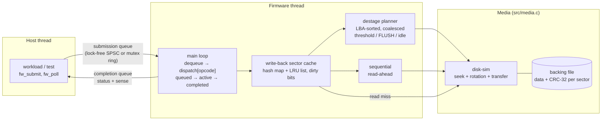

Command path for a write in write-back mode: the host claims a tag
(atomic bitmap), pushes the command, and the firmware pops it. The command
moves to ACTIVE, `dispatch[FW_OP_WRITE]` copies the data into cache entries
and marks them dirty, and the completion is posted. That's the moment the
host is told "written". The media is touched later, when the destage planner
writes the oldest dirty sectors in LBA order. With FUA, or with the cache in
write-through mode, the media write happens *before* the completion.

| File | What it is |
|---|---|
| [src/fwsim.h](src/fwsim.h) | Public API: command struct, opcodes, status/sense codes, config, stats |
| [src/firmware.c](src/firmware.c) | Firmware thread, dispatch table, handlers, destage planner, read-ahead |
| [src/cache.c](src/cache.c) | LRU sector cache: hash map + doubly linked list, dirty bits |
| [src/media.c](src/media.c) | disk-sim timing + backing file + CRC-32 + retries + fault injection + torn writes |
| [src/ring_spsc.c](src/ring_spsc.c) | Lock-free single-producer/single-consumer ring (C11 acquire/release) |
| [src/ring_mutex.c](src/ring_mutex.c) | Bounded ring with mutex + two condition variables |
| [src/squeue.h](src/squeue.h) | Build-time switch between the two rings |
| [src/crc32.c](src/crc32.c) | Table-driven CRC-32 (built once under `pthread_once`) |
| [src/status.c](src/status.c) | Status → SCSI sense key / ASC / ASCQ |
| [src/powerloss.c](src/powerloss.c) | Power-loss trial: write, cut, reboot, verify |
| [src/workload.c](src/workload.c) | Closed-loop host workload generator at a fixed queue depth |
| [bench/bench.c](bench/bench.c), [bench/plot.py](bench/plot.py) | Every experiment → CSV → markdown + PNG |
| [tests/](tests/) | Unit + integration tests (rings, cache, CRC, dispatch, integrity, power loss) |
| [third_party/disk-sim](third_party/disk-sim) | Snapshot of the disk-sim media library (used if no sibling checkout exists) |
| [LEARNING.md](LEARNING.md), [INTERVIEW.md](INTERVIEW.md) | Guided walkthrough; 25 interview questions with model answers |

## Build and run

You need Linux (or WSL) with gcc, make and pthreads. There are no other C
dependencies. `make bench` also wants Python 3 with matplotlib for the PNGs;
the CSV and markdown are produced without it.

disk-sim is picked up from a sibling checkout (`../disk-sim` or
`../Projects/disk-sim`) if there is one. Otherwise the build falls back to
[third_party/disk-sim](third_party/disk-sim), a snapshot of its library
sources (`include/disksim.h` plus `src/`, without its CLI), so a fresh clone
of this repository builds on its own. Pass `DISKSIM_DIR=...` to point
anywhere else.

```bash
make                  # build/lockfree/{fwsim,fwbench}
```
```bash
make test             # all tests, lock-free AND mutex queue builds
```
```bash
make asan             # same, under AddressSanitizer + UBSan
```
```bash
make tsan             # same, under ThreadSanitizer
```
```bash
make bench            # ~2.5 min: results/results.csv, results.md, *.png
```
```bash
make QUEUE=mutex      # build with the mutex/condvar queue instead
```
```bash
./build/lockfree/fwsim --workload mixed --ops 2000 --qd 4 --region 65536 --time-scale 0.25
```

The CLI prints IDENTIFY data, throughput, latency percentiles, cache hit
rate, destage, media and integrity counters for one workload. Run
`fwsim --help` to see the options (`--write-through`, `--fua`,
`--no-readahead`, `--unsorted-destage`, `--flip-prob P`, ...).

### How time works

disk-sim returns the mechanical time of each access in milliseconds. The
firmware **plays that time back in real time, scaled by `time_scale`**: it
sleeps most of the interval, spins the last ~120 µs for precision, and can be
interrupted by a power cut part-way through. Playing time back for real is
what makes the concurrency genuine: the host keeps submitting while the
firmware is "seeking", and a power cut can land mid-seek or mid-destage.
The benchmarks use `time_scale = 0.25`, and all reported times are **drive
time = wall-clock ÷ 0.25**. CPU work in the firmware (memcpy, CRC, hashing)
is not scaled, so it is inflated 4× in drive-time terms. That's a known
approximation (see Limitations). Metrics marked *wall* (the queue
comparisons) are raw wall-clock.

## Results

All numbers below come from one `make bench` run on this code (WSL2
Ubuntu 24.04, gcc 13.3, 12 logical CPUs). The simulated drive is disk-sim's
default 7,200 rpm, ~100 GB, 16-zone drive with a 2 MiB (4,096 × 512 B)
cache. Raw data: [results/results.csv](results/results.csv) and
[results/powerloss_trials.csv](results/powerloss_trials.csv).

<!-- RESULTS:BEGIN -->
_Generated by `make bench` from `results/results.csv`. Time scale 0.25: times are drive time (wall-clock / 0.25) unless marked wall._

### Write-back vs write-through (QD 4, 2 MiB cache)

| Workload | Mode | IOPS (acked) | IOPS (incl. final FLUSH) | p50 ms | p95 ms | p99 ms | Read hit % |
|---|---|---:|---:|---:|---:|---:|---:|
| Random 4K writes, whole 100 GB disk | write-through | 73.1 | 73.1 | 54.20 | 70.03 | 77.04 | - |
| Random 4K writes, whole 100 GB disk | write-back | 190 | 148 | 0.07 | 61.76 | 68.37 | - |
| Random 4K writes, 1 GiB region | write-through | 165 | 165 | 24.11 | 32.87 | 35.72 | - |
| Random 4K writes, 1 GiB region | write-back | 237 | 184 | 0.03 | 51.44 | 56.16 | - |
| 70/30 read/write, 90% of I/O to a hot 1.6 MiB of 32 MiB | write-through | 435 | 435 | 8.77 | 19.68 | 23.95 | 70.0 |
| 70/30 read/write, 90% of I/O to a hot 1.6 MiB of 32 MiB | write-back | 998 | 684 | 2.08 | 14.67 | 18.94 | 70.0 |
| Random 4K reads, whole disk | write-through | 73.9 | 73.9 | 54.20 | 67.67 | 74.73 | 0.0 |
| Random 4K reads, whole disk | write-back | 73.9 | 73.9 | 54.38 | 68.52 | 73.82 | 0.0 |

### Power loss (random 4K writes over 32 MiB, QD 4, cut at a random moment 50-1000 ms)

| Mode | Trials | Acked writes / trial | Lost acked writes / trial (avg) | max | Trials with loss | Durability violations | Write IOPS |
|---|---:|---:|---:|---:|---:|---:|---:|
| Write-back, no FLUSH | 100 | 525 | 351 | 383 | 100 | 0 | 1,400 |
| Write-back + FLUSH every 32 writes | 100 | 122 | 18.5 | 31 | 100 | 0 | 284 |
| Write-back, every write FUA | 100 | 92.4 | 0.0 | 0 | 0 | 0 | 182 |
| Write-through (cache off) | 100 | 93.3 | 0.0 | 0 | 0 | 0 | 176 |

_Lost = the latest acknowledged version of a block is not on the media after reboot. Violation = data the drive promised was durable (FUA / write-through ack, or covered by a completed FLUSH) is missing. Write IOPS = acknowledged writes per second of drive time until the cut._

### Queues: mutex + condvar vs lock-free SPSC

| Measurement | mutex + condvar | lock-free SPSC | ratio |
|---|---:|---:|---:|
| Raw handoff, 1 producer -> 1 consumer, median of 5 (M items/s, wall) | 0.69 | 18.25 | 26.4x |
| Firmware cache-hit READs, QD 1 (K cmds/s, wall) | 20.9 | 1,177 | 56.4x |
| Firmware cache-hit READ latency avg, QD 1 (us, wall) | 47.72 | 0.66 | |
| Firmware cache-hit READs, QD 32 (K cmds/s, wall) | 1,038 | 2,418 | 2.3x |
| Firmware cache-hit READ latency avg, QD 32 (us, wall) | 30.66 | 13.03 | |

### Read-ahead and destage order

| Experiment | Variant | IOPS | IOPS (incl. FLUSH) | p50 ms | p99 ms | Read hit % |
|---|---|---:|---:|---:|---:|---:|
| Sequential 64K reads, QD 1 | read-ahead on | 743 | 743 | 1.24 | 3.29 | 99.9 |
| Sequential 64K reads, QD 1 | read-ahead off | 108 | 108 | 9.18 | 12.76 | 0.0 |
| Random 4K writes, write-back | LBA-sorted destage | 194 | 151 | 0.02 | 67.87 | - |
| Random 4K writes, write-back | age-order destage | 92.9 | 72.0 | 0.04 | 137.3 | - |

### Integrity (CRC-32 per sector, 3 retries)

CRC-32("123456789") = `0xCBF43926` (standard check value 0xCBF43926).

| Sectors read | Persistent flips injected | Transient flips injected | CRC errors detected | Recovered by retry | MEDIUM_ERROR returned (at injected LBA) | Silent corruptions |
|---:|---:|---:|---:|---:|---:|---:|
| 20,000 | 25 | 20 | 45 | 20 | 25 (25) | 0 |

<!-- RESULTS:END -->

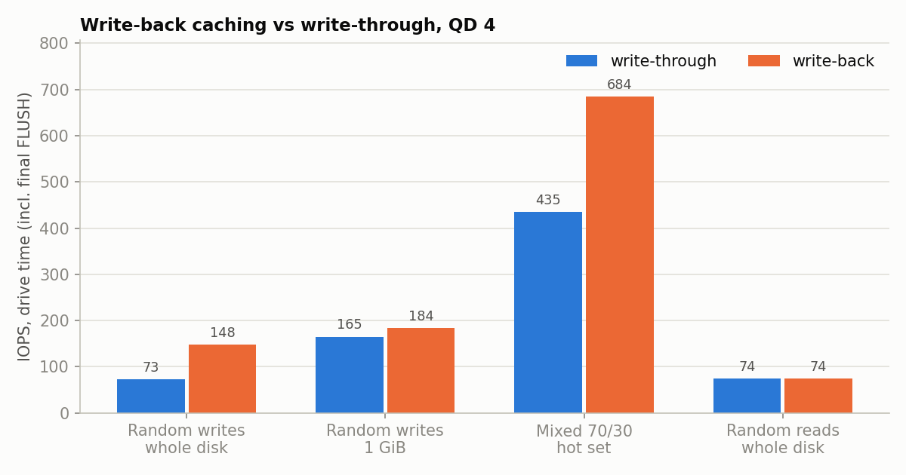
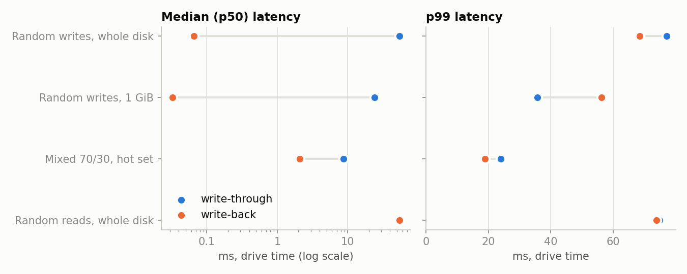
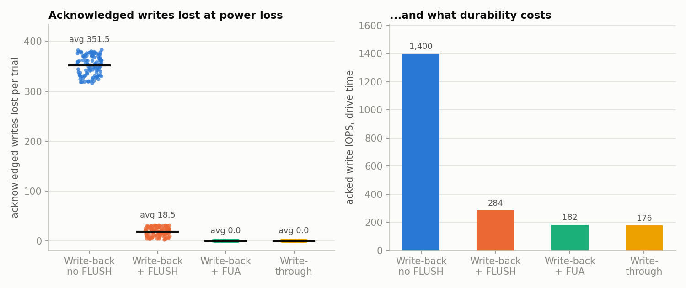
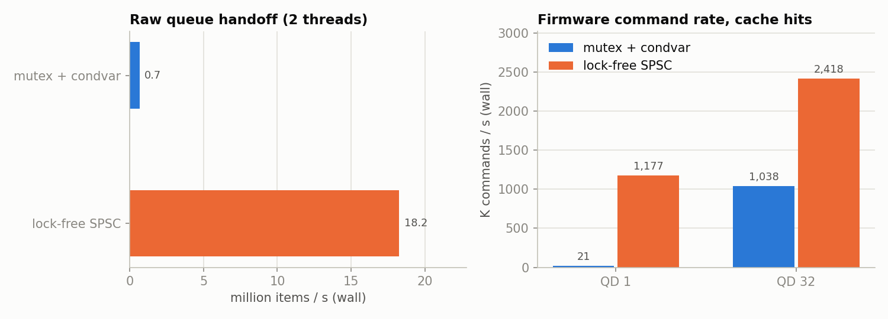
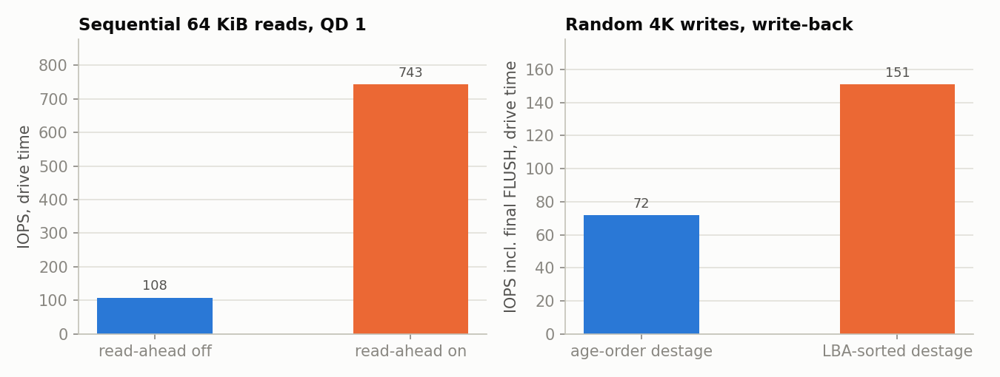

## Key findings

1. **Acknowledged is not durable.** With write-back caching and no FLUSH,
   power loss destroyed acknowledged writes in **100 of 100 trials, 351.5 on
   average (max 383)**, out of about 525 acknowledged per trial. Write-through
   and FUA lost **0** in 200 trials, and no mode ever broke a durability
   promise (0 violations in 400 trials).
2. **FLUSH bounds the damage to the window since the last FLUSH.** With a
   FLUSH every 32 writes, the loss dropped to 18.5 writes per trial (max 31,
   always less than one FLUSH interval), with zero violations.
3. **Durability costs throughput.** In the same power-loss workload,
   acknowledged-write throughput was 1,400 IOPS for write-back, 284 with
   periodic FLUSH, 182 with FUA and 176 for write-through: write-back is
   **7.9×** write-through *until the cache fills*.
4. **Sustained, the cache only helps as much as destaging does.** On random
   4K writes over the whole disk, write-back is **2.0×** write-through when
   you include the final FLUSH (147.6 vs 73.1 IOPS). Median latency drops
   from 54 ms to 0.07 ms, but p99 stays mechanical (68 ms). The gain comes
   from **LBA-sorted destaging**, which alone is 2.1× age-order destaging
   (151.1 vs 72.0 IOPS) and halves p99 (68 vs 137 ms).
5. **Write-back can hurt tail latency.** On random writes confined to 1 GiB,
   write-back p99 was **56 ms vs 36 ms** for write-through: commands queue
   behind background destage writes. Moving media work out of the write path
   doesn't make it disappear.
6. **A hot set that fits in the cache wins twice.** The 70/30 mixed workload
   hit the cache 70% of the time and ran 1.57× faster in write-back (684 vs
   435 IOPS, incl. FLUSH), with p50 down from 8.8 to 2.1 ms.
7. **Read-ahead is about rotation, not just hit rate.** Sequential 64 KiB
   reads at QD 1 ran **6.9× faster** with read-ahead (743 vs 108 IOPS).
   Without it, every command misses a revolution (≈9.2 ms p50 ≈ one 8.3 ms
   revolution plus transfer).
8. **Lock-free beats mutex+condvar most when queues run empty.** The raw
   handoff rate was **26×** higher (18.25 vs 0.69 M items/s). On the real
   firmware at QD 1, cache-hit command rate was **56×** higher (1,177 vs 20.9
   K/s, 0.66 vs 47.7 µs average latency), because every mutex handoff paid a
   futex sleep and wake. At QD 32 the gap shrinks to 2.3×.
9. **CRC + retry: everything detected, nothing silent.** Across 20,000 sector
   reads with 20 transient and 25 persistent bit flips: 45 CRC errors were
   detected, all 20 transient ones were recovered by retry, all 25 persistent
   ones were reported as MEDIUM ERROR at exactly the injected LBA, and there
   were **0 silent corruptions**.

## Examples

These are captures of real runs. [docs/capture.sh](docs/capture.sh) runs
each command and saves its unedited output to `docs/screenshots/*.txt`, and
[docs/render.py](docs/render.py) draws that text as a terminal image. Re-run
both to regenerate them.

**One workload on the CLI.** IDENTIFY, then a 70/30 random read/write mix
over 32 MiB at QD 4. Access is uniform here (the CLI has no hot-set option),
so most reads miss; the benchmark's `mixed_hot` workload adds the hot set:

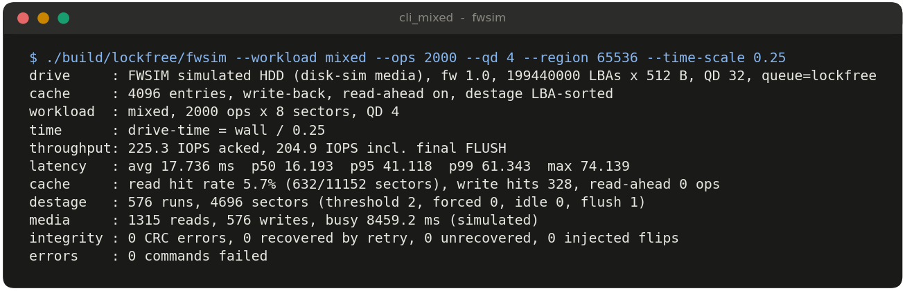

**Write-back vs write-through, same workload.** Compare the IOPS, the
latency and the destage counters:

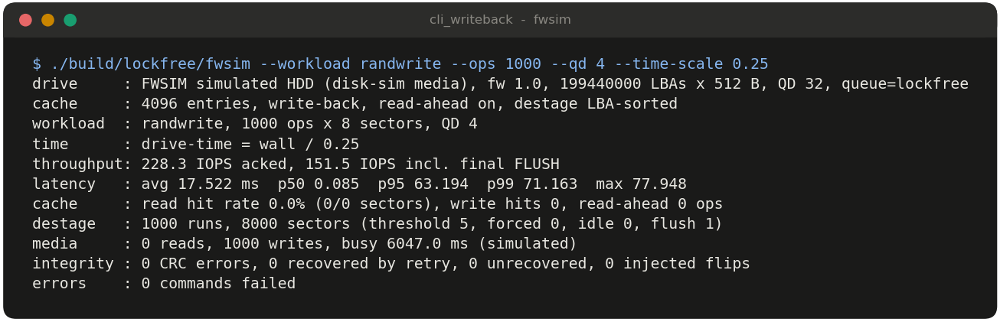
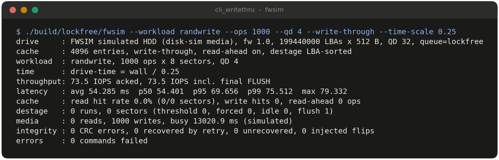

**Fault injection.** With a 1% chance of a read-channel bit flip per sector,
CRC errors are detected and recovered by retry:

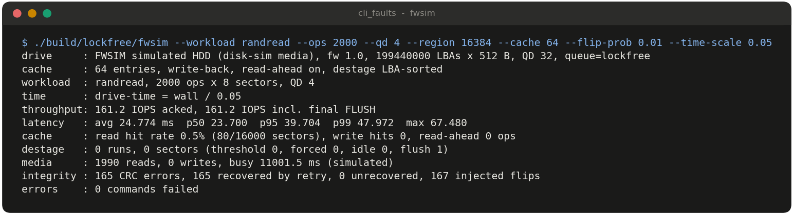

**The power-loss integration test**, including a torn write and the
randomised per-mode trials:

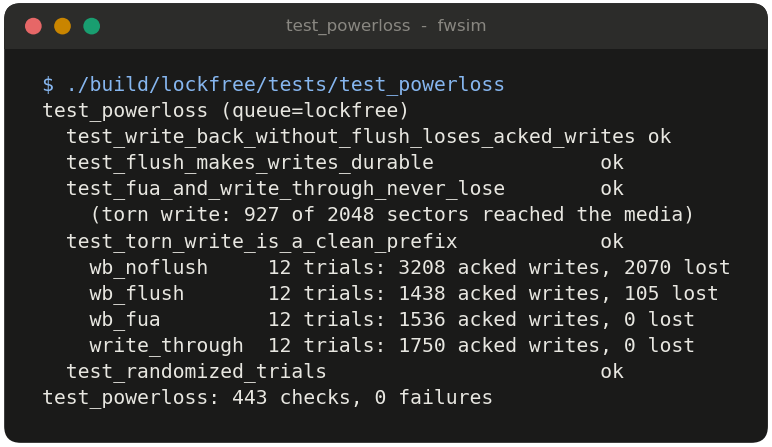

**The power-loss benchmark** (20 trials per mode here; `make bench` runs 100):

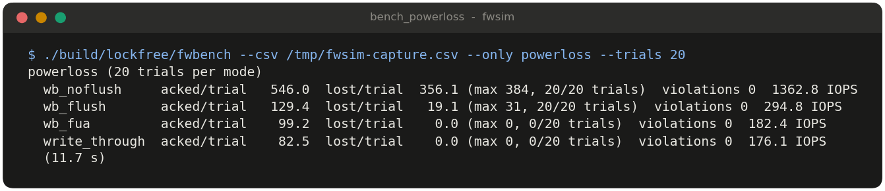

**ThreadSanitizer and AddressSanitizer** over the whole suite, both queue
builds:


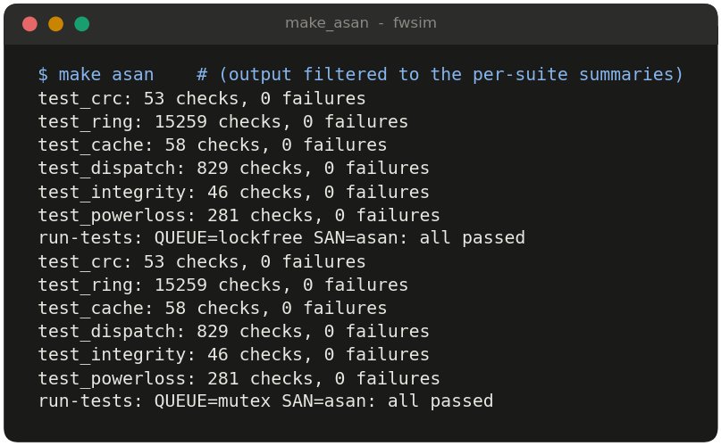

Using the API directly (this is what `fw_exec` wraps):

```c
fw_config_t cfg;
fw_config_default(&cfg);
cfg.media_path = "/tmp/drive.media";
cfg.time_scale = 0.25;                 /* media time played back at 1/4 speed */
fw_t *fw = fw_create(&cfg, NULL);      /* powers on, starts the firmware thread */

uint8_t buf[8 * 512] = { 0 };
fw_cmd_t w = { .opcode = FW_OP_WRITE, .tag = 0, .lba = 4096, .count = 8,
               .buf = buf, .flags = FW_CMD_FUA };     /* durable before the ack */
fw_submit(fw, &w);                     /* ownership passes to the firmware */
fw_cmd_t *done = fw_poll(fw, 100000);  /* ...and back with the completion */
printf("%s, sense %X/%02X\n", fw_status_str(done->status),
       done->sense.key, done->sense.asc);

fw_shutdown(fw);                       /* destage everything, stop */
fw_destroy(fw);
```

## Design decisions

- **One firmware thread owns the cache, the media and the disk-sim handle.**
  A single-core controller runs its command and cache layer exactly like
  this. It means the cache and media code have no locks, no lock ordering
  and no lock overhead, and the only shared state is the queues, the power
  flags, the tag bitmap and the counters. The alternative, a locked cache
  with multiple worker threads, would add contention and still be limited
  by one actuator.
- **Ownership transfer through the queues instead of locking commands.**
  Release/acquire on the queue indices publishes the whole command struct,
  so it needs no lock or atomics of its own.
- **Two queue implementations behind a build-time switch** (`make
  QUEUE=mutex|lockfree`). A static inline wrapper costs nothing on the hot
  path; a runtime function pointer would add an indirect call to the thing
  being measured. Both rings are always compiled, so their unit tests run in
  every build.
- **Per-sector cache entries.** Real drives cache segments, but per-sector
  entries make LRU, dirty tracking and the tests exact. Destage coalescing
  recovers the large sequential media writes.
- **Hash map + doubly linked list LRU, preallocated.** O(1) lookup, touch
  and evict, with no malloc on the I/O path. Eviction skips dirty entries
  because their data exists nowhere else.
- **Background destage as a sorted plan executed in slices** (2 media writes
  between host commands, 1 at a time when the queue is empty). Writing a
  whole 1,000-sector batch at once gave terrible tail latency. Storing LBAs
  rather than pointers in the plan keeps it correct when entries are
  rewritten, cleaned by FUA or evicted mid-plan.
- **Watermark hysteresis (75% → 50%).** It batches enough dirty data to sort
  into an efficient sweep, instead of destaging one sector per write.
- **CRC-32 seeded with the LBA.** It catches misdirected writes as well as
  bit flips. An all-zero record means "never written", so a fresh sparse
  backing file reads as zeros without a format pass.
- **Unrecoverable sectors go on a pending list and are reallocated on the next
  write** (via disk-sim's G-list), never at read time, so the host's data is
  never silently replaced.
- **Power-loss checker distinguishes "lost" from "violation".** Losing
  acknowledged-but-unflushed write-back data is *allowed*; losing data the
  drive promised was durable is a bug. Only the second must be zero.
- **disk-sim compiled from source per build variant.** The sanitizers then
  instrument the media model too. No change to disk-sim's API was needed:
  everything fwsim uses was already public (`disk_service_request`,
  `disk_get_info`, `disk_add_grown_defect`, ...).

## Testing

`make test` runs six test programs, twice (once per queue implementation),
plus five end-to-end CLI runs. `make asan` and `make tsan` run the same
thing under the sanitizers, and both report nothing. I sanity-checked that
TSan in this environment does catch a deliberately racy program.

| Test | Covers |
|---|---|
| `test_ring` | both rings: empty/full, FIFO, wrap-around, `size_t` counter overflow, timeouts, close, 2-thread stress (2 M items), MPMC for the mutex ring, payload publication |
| `test_cache` | LRU order, touch vs peek, dirty never evicted, all-dirty refusal, overwrite/dirty transitions, oldest-first dirty collection, discard, randomized 50k-op comparison against a reference model, strided-LBA hashing |
| `test_crc` | check value 0xCBF43926, known vectors, table vs bitwise, incremental, every single-bit flip detected, bursts ≤ 32 bits detected, concurrent first use |
| `test_dispatch` | IDENTIFY, invalid opcodes + sense, range/overflow validation, tag collision, all 32 tags in flight, FLUSH, FUA, write-through, SET FEATURES, threshold and forced destage, unsorted destage, read-ahead, clean shutdown persistence |
| `test_integrity` | persistent flip → retries → MEDIUM_ERROR at the exact LBA, CRC-field flip, reallocation on rewrite, transient flips recovered with zero silent corruption, misdirected write caught |
| `test_powerloss` | deterministic contracts per mode, torn write is a clean prefix, randomized trials per mode with zero durability violations |

## Limitations

- **Simulated firmware, not real drive code.** No real hardware, interrupts,
  DMA, or SATA/SAS/NVMe protocol. Commands are C structs in shared memory.
- **The firmware executes commands in FIFO order.** Real NCQ firmware
  reorders queued commands by rotational position (that is what disk-sim's
  SPTF scheduler models). Here, only *destaging* is reordered.
- **CPU time is not scaled.** Firmware CPU work is inflated by 1/time_scale
  (4× in the benchmarks) in drive-time terms. That mostly affects cache-hit
  and sequential workloads.
- **Read-ahead streaming** is modelled by starting a continuing prefetch at
  the instant the previous read ended. The transfer time is still charged
  in full, which is conservative.
- **The cache is volatile and there is no power-loss protection.** Nothing
  survives a cut except what is on the media.
- **CRC only, no ECC.** Errors are detected and retried, never corrected.
  Real drives correct most errors with LDPC in the read channel.
- **Torn writes** are modelled at sector granularity within one
  positioning-plus-transfer; a request spanning several tracks is
  approximated.
- **Timing noise.** Wall-clock measurements on a shared WSL2 VM vary from run
  to run, by roughly 10–50% for the queue micro-benchmark. The structural
  results (who wins, zero violations, zero silent corruptions) are stable
  across runs.

## Future work

- Rotational-position (SPTF) reordering of queued host commands, reusing
  disk-sim's `disk_estimate_access()`.
- Read-priority destage scheduling (pause destage while reads are queued) and
  adaptive watermarks.
- Segment-based cache and adaptive read-ahead length.
- An ECC model (e.g. a simple Reed–Solomon or BCH code per sector) so the
  firmware can *correct* as well as detect errors, and correction latency
  shows up in the timing.
- Power-loss protection: a capacitor energy budget that allows destaging N
  sectors after the cut.
- An NVMe-style multi-queue front end (one SPSC queue pair per host core).
