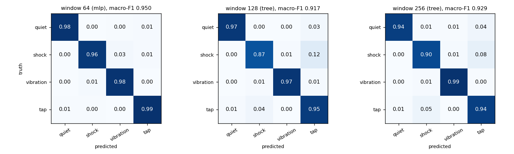
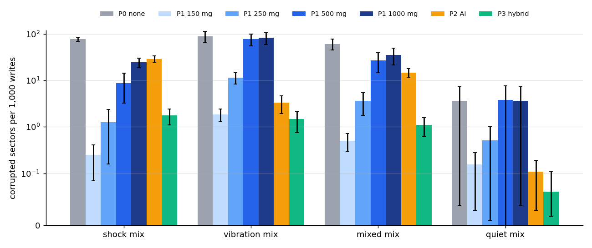
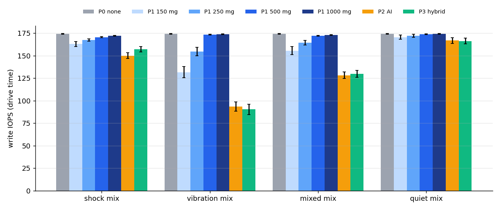
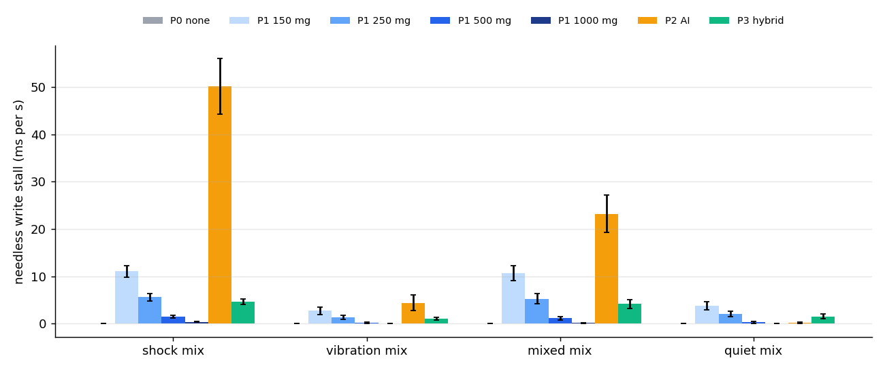

# Edge AI vibration classifier - benchmark results

Generated by `make bench-edgeai` (tools/edgeai/report.py) from real runs. All data is SYNTHETIC (src/periph/env_sim.h); timings in the classifier table are host-CPU wall clock, not MCU time; every system metric is simulated drive time.

## Classifier (held-out test seeds 161-200)

| window | latency (window) | deployed | macro-F1 | recall quiet / shock / vibration / tap | model bytes | features / window | inference / window |
|---|---|---|---|---|---|---|---|
| 64 | 64 ms | mlp | 0.950 | 0.984 / 0.965 / 0.984 / 0.990 | 368 | 3.92 µs | 0.28 µs |
| 128 | 128 ms | tree | 0.917 | 0.969 / 0.865 / 0.974 / 0.951 | 180 | 8.16 µs | 0.01 µs |
| 256 | 256 ms | tree | 0.929 | 0.943 / 0.901 / 0.988 / 0.939 | 180 | 23.96 µs | 0.02 µs |

Times are wall-clock on the HOST CPU (WSL2 x86-64) averaged over all windows of a 20 s recording; they are not MCU timings. On a microcontroller the cost is dominated by the Goertzel loop: 20 bins x N multiply-accumulates (1280, 2560, 5120 for N = 64/128/256).

**Window 64, mlp** - confusion matrix on held-out test seeds 161-200 (74880 windows; rows = truth, columns = prediction):

| truth \ pred | quiet | shock | vibration | tap | recall |
|---|---|---|---|---|---|
| quiet | 43338 | 136 | 188 | 393 | 0.984 |
| shock | 2 | 1971 | 54 | 16 | 0.965 |
| vibration | 52 | 310 | 24575 | 32 | 0.984 |
| tap | 24 | 15 | 1 | 3773 | 0.990 |

**Window 128, tree** - confusion matrix on held-out test seeds 161-200 (74720 windows; rows = truth, columns = prediction):

| truth \ pred | quiet | shock | vibration | tap | recall |
|---|---|---|---|---|---|
| quiet | 37898 | 109 | 18 | 1102 | 0.969 |
| shock | 0 | 2891 | 38 | 412 | 0.865 |
| vibration | 1 | 275 | 24172 | 370 | 0.974 |
| tap | 61 | 305 | 1 | 7067 | 0.951 |

**Window 256, tree** - confusion matrix on held-out test seeds 161-200 (74400 windows; rows = truth, columns = prediction):

| truth \ pred | quiet | shock | vibration | tap | recall |
|---|---|---|---|---|---|
| quiet | 29229 | 267 | 185 | 1300 | 0.943 |
| shock | 0 | 5004 | 78 | 470 | 0.901 |
| vibration | 0 | 192 | 24182 | 101 | 0.988 |
| tap | 99 | 704 | 13 | 12576 | 0.939 |

### Detection vs a threshold

| window | shock events | detected by model | model latency p50 / p90 | detected by 250 mg threshold | threshold latency p50 / p90 | taps tripping threshold | taps called shock | vibration segments tripping threshold |
|---|---|---|---|---|---|---|---|---|
| 64 | 329 | 328 | 10 / 16 ms | 328 | 1 / 2 ms | 265 / 948 | 12 / 948 | 57 / 154 |
| 128 | 325 | 321 | 9 / 15 ms | 324 | 1 / 2 ms | 265 / 947 | 57 / 947 | 57 / 154 |
| 256 | 321 | 317 | 9 / 15 ms | 320 | 1 / 2 ms | 262 / 941 | 117 / 941 | 57 / 154 |

### Deployed model on the system-benchmark mixes

| bench mix (seeds 5001-5030) | windows | accuracy | macro-F1 | recall quiet / shock / vibration / tap | shock precision |
|---|---|---|---|---|---|
| shock | 56160 | 0.983 | 0.954 | 0.983 / 0.975 / 0.984 / 0.988 | 0.909 |
| vibration | 56160 | 0.983 | 0.859 | 0.991 / 0.888 / 0.981 / 0.990 | 0.370 |
| mixed | 56160 | 0.983 | 0.954 | 0.983 / 0.965 / 0.984 / 0.991 | 0.830 |
| quiet | 56160 | 0.996 | 0.737 | 0.998 / 0.000 / 0.974 / 0.998 | 0.000 |

The quiet mix contains no shocks, so its shock recall and F1 are 0 by definition and the 4-class macro-F1 understates it; read accuracy there. On the vibration-heavy mix, strong vibration is sometimes called shock (low shock precision), which makes P2 inhibit writes during vibration.

### Training, quantisation and C/Python agreement

| window | tree depth / nodes | tree val / test macro-F1 | MLP val / test macro-F1 | deployed | C int8 vs Python float (test) | C int8 vs numpy int8 | C tree vs sklearn |
|---|---|---|---|---|---|---|---|
| 64 | 4 / 31 | 0.876 / 0.876 | 0.942 / 0.952 | mlp | 99.86% | 100.00% | 100.00% |
| 128 | 3 / 15 | 0.910 / 0.917 | 0.964 / 0.966 | tree | 99.92% | 100.00% | 100.00% |
| 256 | 3 / 15 | 0.924 / 0.929 | 0.966 / 0.969 | tree | 99.90% | 100.00% | 100.00% |

Deployed default window: **64** (selection rule in tools/edgeai/train.py).

## System: P0 vs P1 vs P2 vs P3 (30 seeds per mix)

Closed-loop random 4 KiB writes, QD 1, write-through, 1 GiB region, 30 s of drive time per run; corruption is counted on read-back after a reboot without the environment.

#### shock mix (30 seeds, mean ± 95% CI)

| policy | corrupted sectors / 1k writes | write IOPS | p99 write latency (ms) | needless stall (ms/s) | total stall (ms/s) | verified writes | silent |
|---|---|---|---|---|---|---|---|
| P0 none | 77.04 ± 8.39 | 174.0 ± 0.4 | 10.0 ± 0.0 | 0.0 ± 0.0 | 0.0 ± 0.0 | 0% | 0 |
| P1 150 mg | 0.25 ± 0.16 | 162.9 ± 2.7 | 13.9 ± 2.9 | 11.0 ± 1.2 | 58.1 ± 14.2 | 0% | 0 |
| P1 250 mg | 1.27 ± 1.11 | 167.3 ± 1.3 | 11.8 ± 2.0 | 5.6 ± 0.7 | 34.4 ± 6.2 | 0% | 0 |
| P1 500 mg | 8.70 ± 5.48 | 170.6 ± 0.6 | 10.1 ± 0.0 | 1.4 ± 0.3 | 17.8 ± 2.1 | 0% | 0 |
| P1 1000 mg | 24.51 ± 5.86 | 172.0 ± 0.5 | 10.0 ± 0.0 | 0.4 ± 0.1 | 10.0 ± 1.2 | 0% | 0 |
| P2 AI | 29.05 ± 4.46 | 150.0 ± 3.1 | 17.8 ± 2.3 | 50.1 ± 5.9 | 70.0 ± 7.9 | 4% | 0 |
| P3 hybrid | 1.76 ± 0.65 | 157.2 ± 3.1 | 18.2 ± 2.3 | 4.6 ± 0.6 | 32.8 ± 5.9 | 4% | 0 |

#### vibration mix (30 seeds, mean ± 95% CI)

| policy | corrupted sectors / 1k writes | write IOPS | p99 write latency (ms) | needless stall (ms/s) | total stall (ms/s) | verified writes | silent |
|---|---|---|---|---|---|---|---|
| P0 none | 88.65 ± 24.49 | 174.0 ± 0.4 | 10.0 ± 0.0 | 0.0 ± 0.0 | 0.0 ± 0.0 | 0% | 0 |
| P1 150 mg | 1.85 ± 0.57 | 131.7 ± 6.4 | 41.7 ± 16.0 | 2.7 ± 0.8 | 231.3 ± 35.2 | 0% | 0 |
| P1 250 mg | 11.51 ± 3.11 | 154.4 ± 4.6 | 27.8 ± 6.6 | 1.4 ± 0.4 | 102.4 ± 24.7 | 0% | 0 |
| P1 500 mg | 77.51 ± 22.61 | 173.2 ± 0.4 | 10.0 ± 0.0 | 0.2 ± 0.2 | 3.9 ± 1.3 | 0% | 0 |
| P1 1000 mg | 82.05 ± 23.50 | 173.8 ± 0.4 | 10.0 ± 0.0 | 0.0 ± 0.0 | 1.0 ± 0.4 | 0% | 0 |
| P2 AI | 3.29 ± 1.36 | 93.4 ± 5.2 | 31.4 ± 2.2 | 4.3 ± 1.7 | 18.1 ± 4.5 | 48% | 0 |
| P3 hybrid | 1.47 ± 0.71 | 90.2 ± 5.9 | 49.3 ± 10.7 | 1.0 ± 0.3 | 98.8 ± 23.9 | 44% | 0 |

#### mixed mix (30 seeds, mean ± 95% CI)

| policy | corrupted sectors / 1k writes | write IOPS | p99 write latency (ms) | needless stall (ms/s) | total stall (ms/s) | verified writes | silent |
|---|---|---|---|---|---|---|---|
| P0 none | 60.95 ± 16.19 | 174.0 ± 0.4 | 10.0 ± 0.0 | 0.0 ± 0.0 | 0.0 ± 0.0 | 0% | 0 |
| P1 150 mg | 0.51 ± 0.21 | 155.5 ± 4.5 | 17.8 ± 4.4 | 10.7 ± 1.6 | 99.6 ± 25.5 | 0% | 0 |
| P1 250 mg | 3.64 ± 1.86 | 164.4 ± 2.6 | 14.9 ± 3.4 | 5.3 ± 1.1 | 49.9 ± 13.8 | 0% | 0 |
| P1 500 mg | 27.16 ± 12.51 | 172.1 ± 0.5 | 10.0 ± 0.0 | 1.1 ± 0.3 | 9.8 ± 1.5 | 0% | 0 |
| P1 1000 mg | 35.23 ± 13.85 | 173.1 ± 0.4 | 10.0 ± 0.0 | 0.1 ± 0.1 | 4.9 ± 0.9 | 0% | 0 |
| P2 AI | 14.81 ± 2.97 | 128.1 ± 3.6 | 22.8 ± 2.1 | 23.2 ± 4.0 | 37.3 ± 6.2 | 18% | 0 |
| P3 hybrid | 1.10 ± 0.47 | 129.9 ± 3.9 | 26.2 ± 3.6 | 4.1 ± 0.9 | 47.2 ± 13.3 | 16% | 0 |

#### quiet mix (30 seeds, mean ± 95% CI)

| policy | corrupted sectors / 1k writes | write IOPS | p99 write latency (ms) | needless stall (ms/s) | total stall (ms/s) | verified writes | silent |
|---|---|---|---|---|---|---|---|
| P0 none | 3.65 ± 3.62 | 174.0 ± 0.4 | 10.0 ± 0.0 | 0.0 ± 0.0 | 0.0 ± 0.0 | 0% | 0 |
| P1 150 mg | 0.16 ± 0.13 | 170.4 ± 2.4 | 10.5 ± 0.9 | 3.8 ± 0.9 | 19.2 ± 12.7 | 0% | 0 |
| P1 250 mg | 0.51 ± 0.50 | 172.2 ± 1.7 | 10.0 ± 0.0 | 2.0 ± 0.6 | 9.3 ± 7.6 | 0% | 0 |
| P1 500 mg | 3.83 ± 3.87 | 174.0 ± 0.4 | 10.0 ± 0.0 | 0.3 ± 0.2 | 0.3 ± 0.2 | 0% | 0 |
| P1 1000 mg | 3.65 ± 3.62 | 174.0 ± 0.4 | 10.0 ± 0.0 | 0.0 ± 0.0 | 0.0 ± 0.0 | 0% | 0 |
| P2 AI | 0.11 ± 0.08 | 166.8 ± 3.2 | 14.1 ± 1.5 | 0.1 ± 0.1 | 1.4 ± 1.2 | 3% | 0 |
| P3 hybrid | 0.06 ± 0.05 | 166.2 ± 3.2 | 13.9 ± 1.5 | 1.5 ± 0.5 | 8.7 ± 7.4 | 2% | 0 |

### Paired differences (same seeds, same writes)

| mix | comparison | Δ corrupted / 1k writes | Δ write IOPS | Δ p99 (ms) | Δ needless stall (ms/s) |
|---|---|---|---|---|---|
| shock | P2 AI − P1 150 mg (best P1) | +28.80 ± 4.44 ▲ | -12.94 ± 2.49 ▼ | +3.92 ± 2.57 ▲ | +39.12 ± 5.32 ▲ |
| shock | P2 AI − P1 250 mg | +27.78 ± 4.58 ▲ | -17.31 ± 2.63 ▼ | +5.97 ± 2.11 ▲ | +44.59 ± 5.62 ▲ |
| shock | P3 hybrid − P1 150 mg (best P1) | +1.51 ± 0.70 ▲ | -5.79 ± 2.41 ▼ | +4.31 ± 3.03 ▲ | -6.39 ± 0.75 ▼ |
| shock | P3 hybrid − P1 250 mg | +0.49 ± 1.33 | -10.16 ± 2.69 ▼ | +6.37 ± 1.27 ▲ | -0.92 ± 0.26 ▼ |
| vibration | P2 AI − P1 150 mg (best P1) | +1.44 ± 1.46 | -38.23 ± 5.25 ▼ | -10.32 ± 15.66 | +1.62 ± 1.75 |
| vibration | P2 AI − P1 250 mg | -8.22 ± 3.09 ▼ | -61.01 ± 5.52 ▼ | +3.62 ± 5.67 | +2.97 ± 1.73 ▲ |
| vibration | P3 hybrid − P1 150 mg (best P1) | -0.39 ± 0.98 | -41.42 ± 4.65 ▼ | +7.62 ± 11.19 | -1.72 ± 0.55 ▼ |
| vibration | P3 hybrid − P1 250 mg | -10.05 ± 2.84 ▼ | -64.20 ± 5.06 ▼ | +21.57 ± 4.97 ▲ | -0.36 ± 0.20 ▼ |
| mixed | P2 AI − P1 150 mg (best P1) | +14.30 ± 3.02 ▲ | -27.40 ± 4.43 ▼ | +4.95 ± 4.14 ▲ | +12.52 ± 4.12 ▲ |
| mixed | P2 AI − P1 250 mg | +11.16 ± 3.03 ▲ | -36.32 ± 3.63 ▼ | +7.87 ± 3.04 ▲ | +17.93 ± 4.10 ▲ |
| mixed | P3 hybrid − P1 150 mg (best P1) | +0.60 ± 0.54 ▲ | -25.63 ± 3.94 ▼ | +8.38 ± 4.57 ▲ | -6.53 ± 0.97 ▼ |
| mixed | P3 hybrid − P1 250 mg | -2.54 ± 1.78 ▼ | -34.54 ± 3.37 ▼ | +11.30 ± 2.10 ▲ | -1.12 ± 0.36 ▼ |
| quiet | P2 AI − P1 150 mg (best P1) | -0.05 ± 0.14 | -3.61 ± 2.63 ▼ | +3.65 ± 1.51 ▲ | -3.66 ± 0.88 ▼ |
| quiet | P2 AI − P1 250 mg | -0.40 ± 0.52 | -5.34 ± 2.94 ▼ | +4.09 ± 1.45 ▲ | -1.86 ± 0.59 ▼ |
| quiet | P3 hybrid − P1 150 mg (best P1) | -0.09 ± 0.13 | -4.19 ± 2.43 ▼ | +3.46 ± 1.51 ▲ | -2.28 ± 0.52 ▼ |
| quiet | P3 hybrid − P1 250 mg | -0.45 ± 0.51 | -5.92 ± 2.81 ▼ | +3.90 ± 1.45 ▲ | -0.48 ± 0.20 ▼ |

▼ / ▲: the paired 95% CI excludes 0 (significantly lower / higher). Lower is better for corruption, p99 and stall; higher is better for IOPS.

