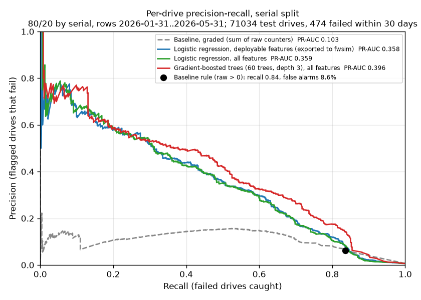
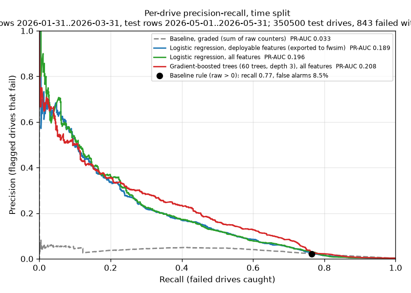
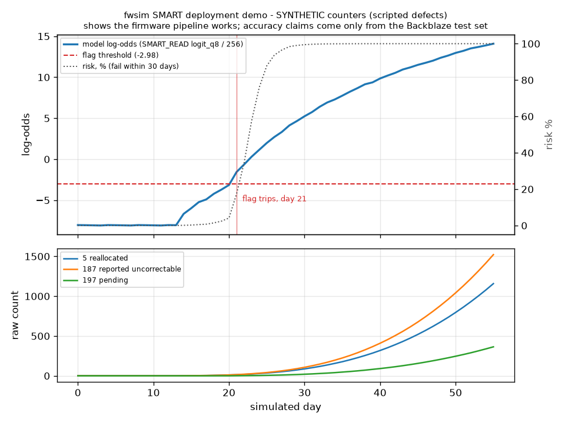

# SMART failure prediction: results

_Generated by `make bench-smart` (tools/smart/report.py). Data: Backblaze Drive Stats Q1_2026, Q2_2026 (2026-01-01 .. 2026-06-30), data HDDs of 4 TB and up. Label: the drive fails within 30 days. Unit: one drive over the test window (flagged if any day's score crosses the threshold). False-alarm rate = healthy drives flagged / healthy drives._

## serial split: 80/20 by serial, rows 2026-01-31..2026-05-31

71,034 test drives, 474 failed (positive rate 0.7%). Training: 697,078 drive-days (37,498 positive).

Baseline rule (any raw > 0) as a single operating point: recall **83.5%** at **8.6%** false alarms (precision 6.1%, 396 of 474 failures caught, 6,056 healthy drives flagged).

| Model | PR-AUC (95% CI) | Recall at 1% false alarms (95% CI) | Recall at the rule's 8.6% false alarms |
|---|---:|---:|---:|
| Baseline rule, graded (sum of raw 5/187/188/197/198) | 0.103 (0.090-0.120) | 11.0% (8-16%) | 83.5% |
| Logistic regression, deployable features (in fwsim) | 0.358 (0.312-0.410) | 61.4% (56-66%) | 84.6% |
| Logistic regression, all features | 0.359 (0.314-0.414) | 59.9% (56-64%) | 84.4% |
| Gradient-boosted trees (60 x depth 3), all features | 0.396 (0.349-0.449) | 65.0% (60-70%) | 85.4% |

## time split: train rows 2026-01-31..2026-03-31, test rows 2026-05-01..2026-05-31

350,500 test drives, 843 failed (positive rate 0.2%). Training: 425,323 drive-days (20,682 positive).

Baseline rule (any raw > 0) as a single operating point: recall **76.5%** at **8.5%** false alarms (precision 2.1%, 645 of 843 failures caught, 29,805 healthy drives flagged).

| Model | PR-AUC (95% CI) | Recall at 1% false alarms (95% CI) | Recall at the rule's 8.5% false alarms |
|---|---:|---:|---:|
| Baseline rule, graded (sum of raw 5/187/188/197/198) | 0.033 (0.029-0.038) | 12.2% (10-15%) | 76.5% |
| Logistic regression, deployable features (in fwsim) | 0.189 (0.161-0.217) | 52.9% (49-56%) | 77.8% |
| Logistic regression, all features | 0.196 (0.165-0.220) | 52.6% (49-55%) | 78.3% |
| Gradient-boosted trees (60 x depth 3), all features | 0.208 (0.181-0.240) | 60.1% (57-63%) | 80.1% |

Deployed threshold (chosen for 1% false alarms on a 31-day window of the TRAINING period, never the test set; log-odds -2.98, i.e. flag at a predicted 4.8% chance of failing within 30 days): on the test window recall **53.9%** at **1.1%** false alarms (precision 10.7%).

## Per manufacturer (test drives)

### serial split

| Group | Drives | Failed | Rule recall / false alarms | LR-deploy PR-AUC | LR-full PR-AUC | GBT PR-AUC | Graded-rule recall @1% | LR-deploy recall @1% | GBT recall @1% |
|---|---:|---:|---:|---:|---:|---:|---:|---:|---:|
| HGST | 5,374 | 100 | 95.0% / 10.0% | 0.389 | 0.387 | 0.353 | 39.0% | 35.0% | 30.0% |
| Seagate | 22,677 | 183 | 81.4% / 15.1% | 0.470 | 0.467 | 0.483 | 20.2% | 70.5% | 70.5% |
| Toshiba | 25,246 | 126 | 77.8% / 5.9% | 0.327 | 0.327 | 0.428 | 42.1% | 58.7% | 59.5% |
| WDC | 17,737 | 65 | 83.1% / 3.7% | 0.202 | 0.207 | 0.220 | 58.5% | 56.9% | 47.7% |
| &nbsp;&nbsp;Toshiba TOSHIBA MG08ACA16TA | 8,102 | 40 | 70.0% / 10.3% | 0.384 | 0.375 | 0.373 | 45.0% | 45.0% | 45.0% |
| &nbsp;&nbsp;Toshiba TOSHIBA MG07ACA14TA | 7,501 | 51 | 94.1% / 3.4% | 0.581 | 0.591 | 0.643 | 80.4% | 84.3% | 82.4% |
| &nbsp;&nbsp;Toshiba TOSHIBA MG10ACA20TE | 5,063 | 13 | 76.9% / 1.2% | 0.618 | 0.605 | 0.551 | 76.9% | 69.2% | 69.2% |
| &nbsp;&nbsp;Toshiba TOSHIBA MG11ACA24TE | 1,940 | 2 | 50.0% / 1.8% | 0.505 | 0.520 | 0.504 | 50.0% | 50.0% | 50.0% |
| &nbsp;&nbsp;Toshiba TOSHIBA MG08ACA16TE | 1,267 | 5 | 80.0% / 16.0% | 0.270 | 0.265 | 0.369 | 20.0% | 40.0% | 40.0% |
| &nbsp;&nbsp;Toshiba TOSHIBA MG08ACA16TEY | 991 | 13 | 46.2% / 9.9% | 0.148 | 0.142 | 0.154 | 7.7% | 15.4% | 15.4% |

### time split

| Group | Drives | Failed | Rule recall / false alarms | LR-deploy PR-AUC | LR-full PR-AUC | GBT PR-AUC | Graded-rule recall @1% | LR-deploy recall @1% | GBT recall @1% |
|---|---:|---:|---:|---:|---:|---:|---:|---:|---:|
| HGST | 25,545 | 140 | 92.1% / 9.9% | 0.194 | 0.189 | 0.151 | 37.1% | 40.0% | 35.0% |
| Seagate | 111,538 | 316 | 76.3% / 15.3% | 0.311 | 0.323 | 0.303 | 19.9% | 64.6% | 65.5% |
| Toshiba | 124,581 | 253 | 69.2% / 5.8% | 0.143 | 0.137 | 0.210 | 42.3% | 51.8% | 58.1% |
| WDC | 88,836 | 134 | 74.6% / 3.5% | 0.121 | 0.122 | 0.079 | 50.7% | 54.5% | 52.2% |
| &nbsp;&nbsp;Toshiba TOSHIBA MG08ACA16TA | 39,890 | 61 | 67.2% / 10.0% | 0.192 | 0.185 | 0.184 | 49.2% | 49.2% | 49.2% |
| &nbsp;&nbsp;Toshiba TOSHIBA MG07ACA14TA | 37,098 | 106 | 83.0% / 3.2% | 0.307 | 0.299 | 0.386 | 63.2% | 73.6% | 79.2% |
| &nbsp;&nbsp;Toshiba TOSHIBA MG10ACA20TE | 24,907 | 39 | 51.3% / 1.2% | 0.254 | 0.263 | 0.251 | 51.3% | 48.7% | 51.3% |
| &nbsp;&nbsp;Toshiba TOSHIBA MG11ACA24TE | 9,601 | 6 | 33.3% / 1.6% | 0.048 | 0.051 | 0.013 | 33.3% | 33.3% | 33.3% |
| &nbsp;&nbsp;Toshiba TOSHIBA MG08ACA16TE | 6,290 | 10 | 80.0% / 15.3% | 0.096 | 0.118 | 0.147 | 30.0% | 60.0% | 50.0% |
| &nbsp;&nbsp;Toshiba TOSHIBA MG08ACA16TEY | 4,839 | 28 | 50.0% / 10.9% | 0.040 | 0.051 | 0.050 | 10.7% | 14.3% | 21.4% |

"Recall @1%" here uses each group's own 1%-false-alarm threshold. Groups with few failures have wide error bars; treat their numbers as indicative.

## C firmware vs Python (time-split test set)

- rows scored: 10,779,155
- C logit identical to the Python integer reference: **100.0000%**
- predicted-failure flag, C vs float scikit-learn: **100.0000%** agree (0 rows differ)
- quantisation error vs float: max |logit| 0.0042 (mean 0.0020); max |probability| 0.00109 (weights: int16)
- the same model with int8 weights would cost max |logit| 0.215, max |probability| 0.0376, flag agreement 99.9962%; int16 costs 17 bytes more

## Model size and inference time

- model tables: **602 bytes** (34 B int16 weights + 34 B zero points + 514 B sigmoid LUT + constants); per-drive state 1608 bytes (32-day history)
- GBT for comparison: 896 tree nodes (not exported)
- **host CPU** (x86-64 under WSL2, not a drive controller): logit 14.9 ns/call, logit + risk 20.3 ns, features + logit + risk 274.4 ns

## Deployment demo (synthetic counters)

The demo's defects are scripted; it shows the firmware pipeline works, not how accurate the model is. Accuracy claims come only from the tables above.
